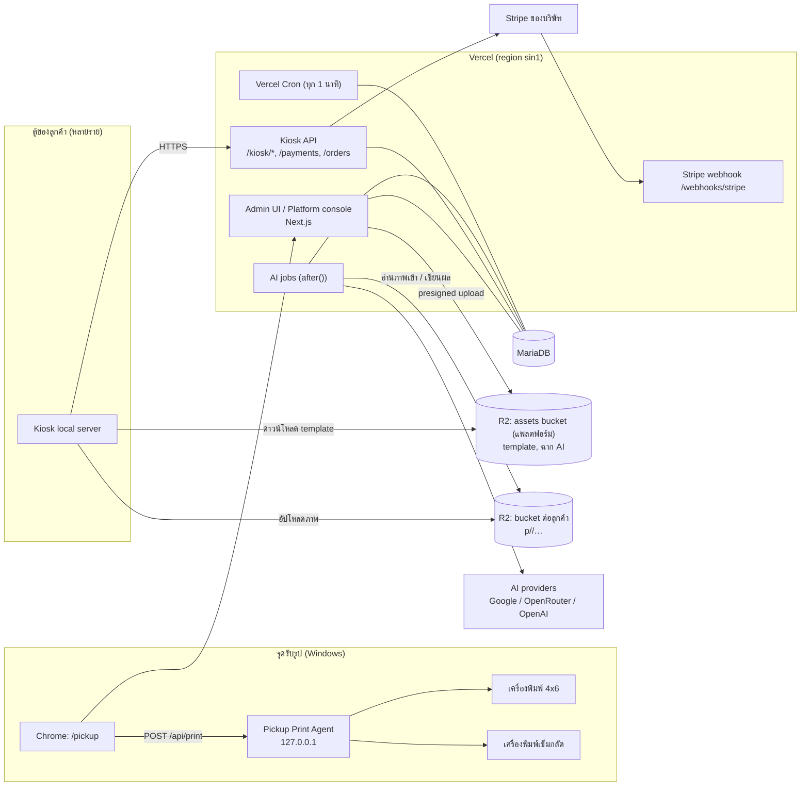
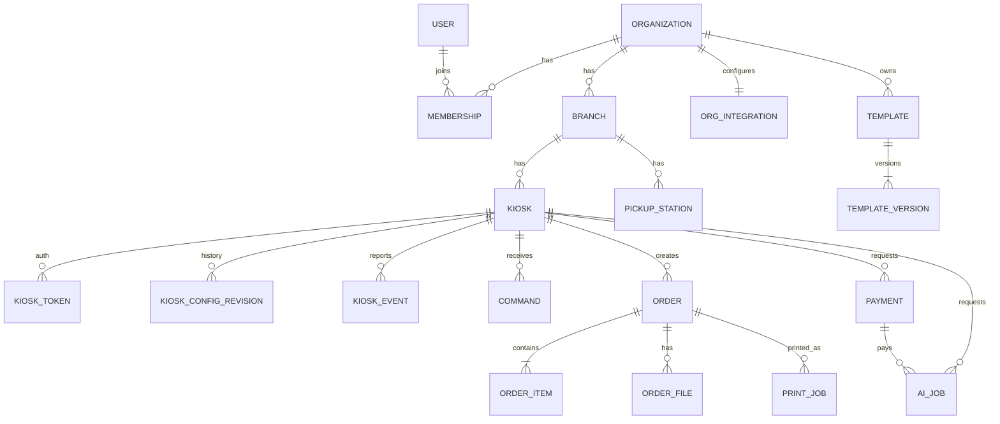
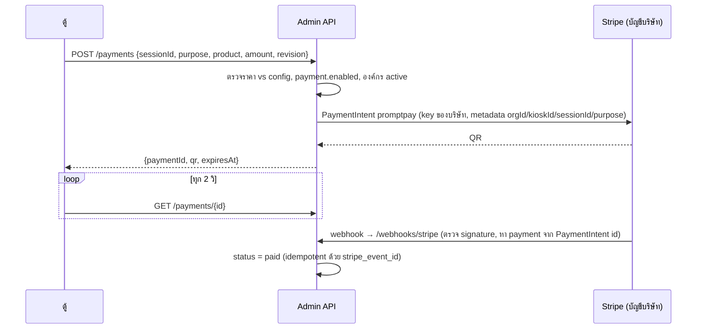
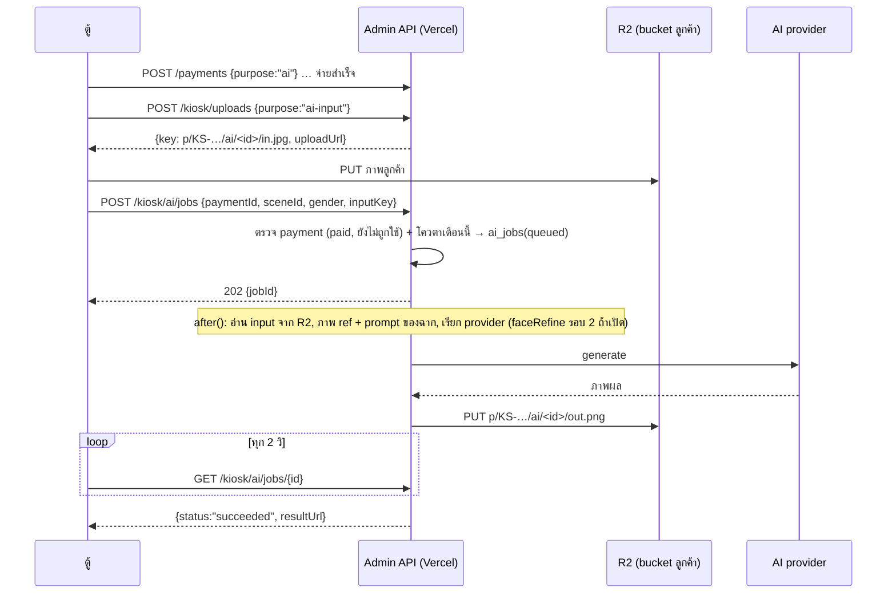
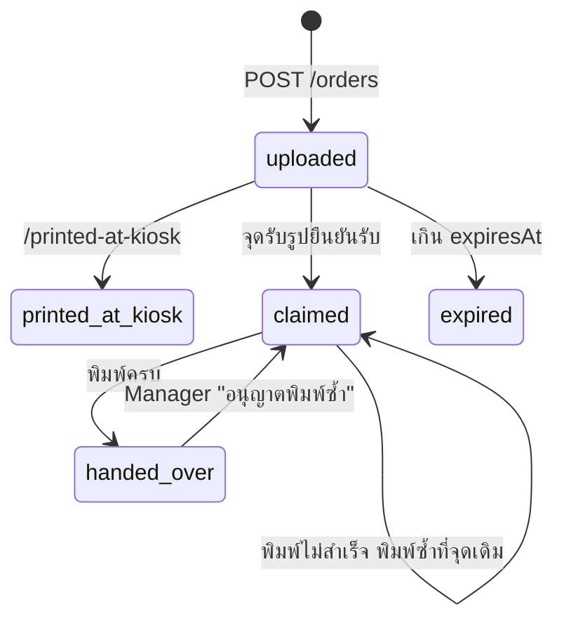
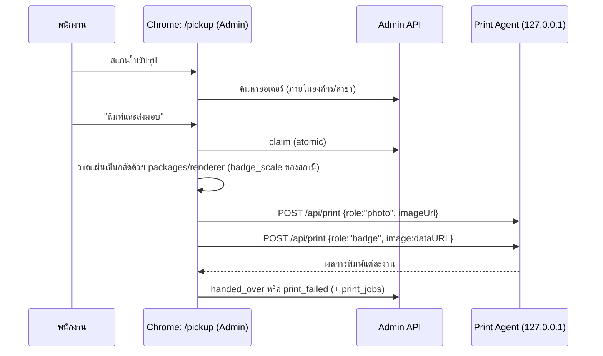
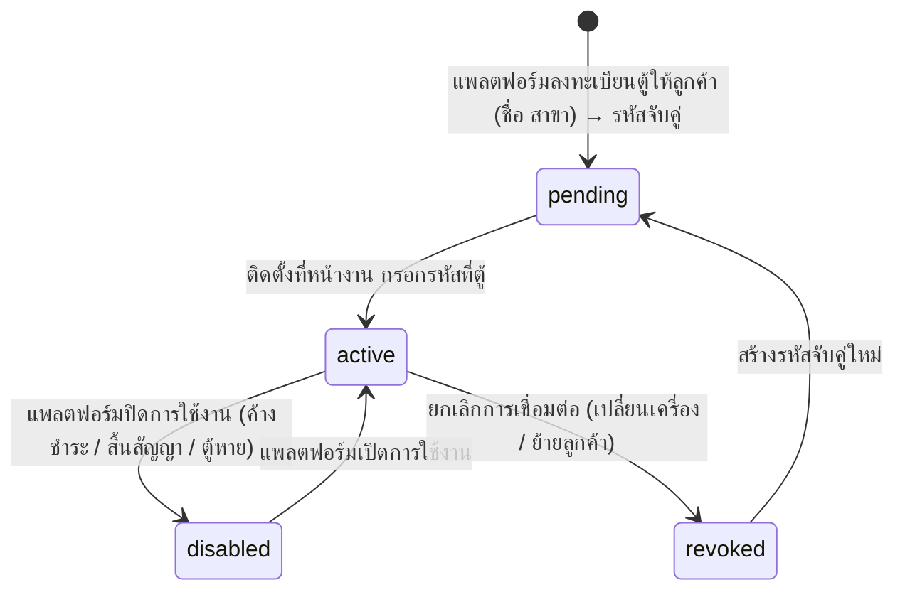
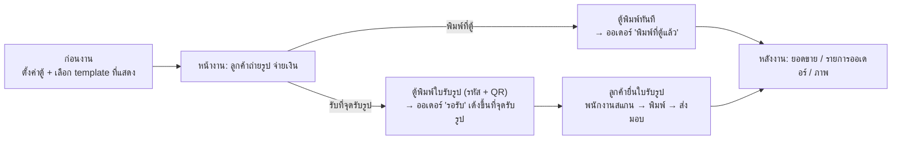

# SCLUO-DIO Photobooth — Web Admin: System Design

ฉบับร่าง 3 • 1 ต.ค. 2569 • สถานะ: **รออนุมัติก่อนเริ่มพัฒนา**
อ้างอิงฝั่งตู้: `C:\my-dev\photobooth-v1` (โดยเฉพาะ `docs/WEB_ADMIN_INTEGRATION.md` ฉบับที่ 3 ที่ตกลงครบ 11 ข้อ)

เอกสารนี้เป็นโครงสำหรับเริ่มพัฒนา Web Admin ครอบคลุมขอบเขต สถาปัตยกรรม โมเดลข้อมูล API หน้าจอ ความปลอดภัย และลำดับงาน ทุกชื่อฟิลด์ที่เกี่ยวกับตู้ใช้ key เดียวกับโค้ดตู้ปัจจุบัน

### ข้อตัดสินใจที่ได้รับแล้ว (ฉบับที่ 2)

| # | เรื่อง | ข้อสรุป | ผลต่อการออกแบบ |
|---|---|---|---|
| D1 | ฐานข้อมูล / Deploy | **MariaDB** + **Vercel** | Drizzle (MySQL dialect) + `mysql2`, ออกแบบให้เข้ากับข้อจำกัด serverless ของ Vercel (ข้อ 4.3) |
| D2 | ผู้ใช้ระบบ | **หลายลูกค้า (multi-tenant)** ลูกค้า 1 รายมีหลายตู้ จัดการตู้ของตัวเอง | ทุกข้อมูลผูก `org_id`, แยกผู้ดูแลแพลตฟอร์มกับผู้ใช้ของลูกค้า, R2 bucket แยกต่อลูกค้า |
| D3 | AI | **Admin เรียก AI แทนตู้** | AI key อยู่ที่แพลตฟอร์มที่เดียว, API งาน AI แบบ async, นับการใช้งานและโควตาต่อลูกค้า |
| D4 | เครื่องพิมพ์จุดรับรูป | **ภาพ 4x6 กับเข็มกลัดคนละเครื่อง** | ใช้ **Pickup Print Agent** ในเครื่อง แทน Chrome `--kiosk-printing` (ข้อ 8.6) |
| D5 | แจ้งเตือนภายนอก / คืนเงิน / config ชุดเดียวหลายตู้ | **ยังไม่ทำใน v1** | ตัดออกจาก v1 |
| D6 | บัญชีรับเงิน | **Stripe ของบริษัท (บัญชีเดียว)** | เงินจากทุกตู้ทุกลูกค้าเข้าบัญชีบริษัท, key/webhook อยู่ระดับแพลตฟอร์ม, ทุกรายการติด `org_id` เพื่อทำรายงานยอดต่อลูกค้า (ข้อ 8.4) |
| D7 | ค่า AI | **แพลตฟอร์มออกค่า AI ก่อน** v1 บันทึกการใช้ + โควตา | ยังไม่มีระบบเรียกเก็บเงินลูกค้า |
| D9 | Print Agent | **ทีม Admin ทำโปรแกรมแยก** (`apps/print-agent`) | โปรแกรม Windows เล็ก รันเบื้องหลัง ใช้วิธีพิมพ์แบบเดียวกับตู้ (อ้างอิง `xprinter_direct.cs` / `printImage.ps1`) ทีมตู้ไม่ต้องทำโหมดใหม่ |
| D10 | ส่วนแบ่งรายได้ | **ไม่มีส่วนแบ่ง** | ไม่มีการคำนวณ settlement ในระบบ, รายงานยอดต่อลูกค้าใช้ดูเพื่อการบริหาร |
| D11 | Auth | **session module ของเราเอง** (แทน Auth.js) | Credentials อย่างเดียว + session ใน DB, ไม่ต้องพึ่ง Auth.js v5 ที่ออกแบบ credentials คู่ JWT |
| D8 | ฉาก AI | **ส่วนกลางสร้าง/อัปเดตเท่านั้น** ลูกค้าเลือกเปิด/ปิดได้อย่างเดียว | ฉาก AI มีเฉพาะใน catalog กลาง (`org_id = NULL`) |

---

## สารบัญ

1. [สรุปสิ่งที่ได้จากการศึกษาฝั่งตู้](#1-สรุปสิ่งที่ได้จากการศึกษาฝั่งตู้)
2. [เป้าหมายและขอบเขต](#2-เป้าหมายและขอบเขต)
3. [Multi-tenant ผู้ใช้และสิทธิ์](#3-multi-tenant-ผู้ใช้และสิทธิ์)
4. [สถาปัตยกรรมและ Tech Stack](#4-สถาปัตยกรรมและ-tech-stack)
5. [โครงสร้างโปรเจกต์](#5-โครงสร้างโปรเจกต์)
6. [โมเดลข้อมูล (MariaDB)](#6-โมเดลข้อมูล-mariadb)
7. [Kiosk API (สัญญากับตู้)](#7-kiosk-api-สัญญากับตู้)
8. [Flow หลัก](#8-flow-หลัก)
9. [หน้าจอและเมนู](#9-หน้าจอและเมนู)
10. [Template Pipeline](#10-template-pipeline)
11. [ความปลอดภัย](#11-ความปลอดภัย)
12. [Non-functional](#12-non-functional)
13. [ลำดับการพัฒนา](#13-ลำดับการพัฒนา)
14. [สิ่งที่ทีมตู้ต้องปรับ](#14-สิ่งที่ทีมตู้ต้องปรับ)
15. [ความเสี่ยงและข้อสังเกต](#15-ความเสี่ยงและข้อสังเกต)
16. [คำถามที่ยังเหลือ](#16-คำถามที่ยังเหลือ)

---

## 1. สรุปสิ่งที่ได้จากการศึกษาฝั่งตู้

**ตัวตู้:** React 18 + Vite (หน้าจอลูกค้า + หน้า Config) และ Node server ในเครื่อง (`server.cjs` / `kioskApi.cjs`, รับเฉพาะ 127.0.0.1) บน Windows

| ด้าน | สิ่งที่มีในตู้ตอนนี้ | ผลต่อ Admin |
|---|---|---|
| โหมด (`appMode`) | `classic` ใบเสร็จขาวดำ • `ai` AI Studio • `photo` ภาพสี 4x6 + เข็มกลัด • `pickup` จุดรับรูป | Admin เลือกโหมดต่อตู้ |
| สินค้า Photo 4x6 | `photo` / `badge` / `bundle` เปิด-ปิดและตั้งราคาแยก (`photoSell*`, `photoPrice`, `badgePrice`, `bundlePrice`) | ตั้งที่ Admin |
| ราคา Classic | 4 แบบใน `templateData.js`: newspaper 40, receipt 30, filmstrip 50, polaroid 35 | ย้ายมาตั้งที่ Admin |
| AI | `aiPrice` 69, `aiAllowRegenerate`, `aiDemoMode`, provider (google / openrouter / openai), model, `imageSize`, `faceRefine` • ฉาก AI 10 แบบ (neon-city, astronaut, hollywood, rockstar, superhero, seoul-romance, noir, fantasy, racing, lost-temple) มีภาพ ref แยกชาย/หญิง | **Admin เป็นผู้เรียก AI (D3)** + จัดการฉาก |
| Template 4x6 | 19 แบบ (15 แบบหลัก + ชุด classic 4 แบบ: dailynews, receipt, polaroid, filmduo 3 ช็อต) • ฟิลเตอร์ 6 แบบ | เปิด/ปิดด้วย id + อัปโหลดเพิ่ม |
| เข็มกลัด | ขนาด 32/44/58/75 มม. • กรอบ 8 แบบ (ring, clean, minimal, pastel, gold, neon, pop, y2k) • `badgeCopies` | ตั้งที่ Admin |
| ธีมงาน | preset 8 แบบ (general, wedding, birthday, party, corporate, graduation, festival, christmas) | คลัง preset |
| การรับเงิน | Stripe PromptPay (`stripePayment.cjs`), log แยก live / test / simulated | ย้ายมาที่ Admin (ทางเลือก B) |
| ไฟล์ภาพ | Cloudflare R2 bucket เดียว, `p/<KioskID>/<yyyymmdd>/…` และ `p/<KioskID>/o/<รหัส>/…`, lifecycle ลบตาม `retentionDays` | **แยก bucket ต่อลูกค้า (D2)** โครงโฟลเดอร์ในตู้เหมือนเดิม |
| ออเดอร์ | รหัส 6 ตัว (เช่น `ZHK-6Q6`), ข้อมูลออเดอร์อยู่ใน metadata ของไฟล์ R2, claim ครั้งเดียว (`PU0002`) | DB ของ Admin เป็นแหล่งจริง |
| ตัวตนตู้ | `kioskId` (เช่น `KS-357C1501`) + fingerprint จาก Windows MachineGuid + name/location | key หลักอ้างอิงตู้ |
| System Log | level `info/warn/error`, category `payment, share, pickup, camera, ai, database, system, printer, config, kiosk…` | รับผ่าน events |
| Error codes | `aiErrorCodes.json` 39 รหัส 17 กลุ่ม (CR, AK, NW, PR, PM, CM, SH, PU, DB …) มี title/cause/fix/retryable | ใช้ชุดเดียวกัน + เพิ่มกลุ่ม `AD` |
| ค่าฝั่งฮาร์ดแวร์ | printer, กล้อง, `badgeCutMm`, `badgeScale` | ตู้เป็นเจ้าของ Admin อ่านอย่างเดียว |
| การพิมพ์ | `/api/print` ของตู้เลือกเครื่องพิมพ์ตามชื่อได้ (`xprinter_direct.exe`, `printImage.ps1` หมุนและขยาย 4x6 ไร้ขอบให้เอง) | ใช้เป็นต้นแบบของ Pickup Print Agent (D4, D9) |

**สัญญาที่ตกลงแล้ว (ฝั่งตู้):** Pairing ด้วยรหัส 8 หลัก → deviceToken • config เอกสารเดียวมี `revision` ตู้ poll ทุก 60 วิ • events ชุดละ ≤10 idempotent ด้วย `eventId` • คำสั่ง 6 แบบผ่านคำตอบ heartbeat • template แบบ Overlay PNG + ไฟล์กำหนดช่อง • ตู้ออกรหัสออเดอร์ Admin ตอบ 409 เมื่อซ้ำ • จุดรับรูปเป็นหน้าเว็บใน Admin

---

## 2. เป้าหมายและขอบเขต

### เป้าหมาย
1. **แพลตฟอร์มให้หลายลูกค้า** — ลูกค้าแต่ละรายเข้าระบบมาจัดการตู้ของตัวเอง เห็นเฉพาะข้อมูลของตัวเอง
2. **จัดการตู้จากที่เดียว** — ลงทะเบียน ดูสถานะสด ตั้งค่า สั่งงานระยะไกล
3. **เป็นเจ้าของข้อมูลธุรกิจ** — ออเดอร์ การชำระเงิน ยอดขาย การใช้ AI อยู่ในฐานข้อมูลกลาง
4. **บริการ AI กลาง** — ตู้ไม่ถือ AI key แพลตฟอร์มควบคุมต้นทุนและโควตาต่อลูกค้า
5. **จุดรับรูปบนเว็บ** — ค้นหา ยืนยันรับ พิมพ์ภาพ 4x6 และแผ่นเข็มกลัดไปคนละเครื่องพิมพ์
6. **คลัง template** — อัปโหลดและตั้งช่องรูป/ข้อความได้เองโดยไม่ต้องเขียนโค้ด
7. **ตู้ทำงานต่อได้เมื่อ Admin ล่ม** ยกเว้นการรับเงินจริงและ AI

### อยู่ในขอบเขต v1
Platform console (ลูกค้า, โควตา, catalog กลาง, AI key) • Auth + RBAC สองระดับ • สาขา • ตู้ + pairing • heartbeat/สถานะ • config editor + revision + ack • events/log • คำสั่งระยะไกล 6 แบบ • ออเดอร์ • หน้าจุดรับรูป + Print Agent • Stripe PromptPay (บัญชีบริษัท) + รายงานยอดต่อลูกค้า • AI proxy • คลัง template (4x6 / เข็มกลัด / classic / ฉาก AI) • ธีมงาน • รายงาน • audit log

### ไม่อยู่ใน v1
แจ้งเตือนภายนอก (LINE/Email) • ปุ่มคืนเงิน (ทำใน Stripe dashboard) • config ชุดเดียวใช้หลายตู้ • สมัครใช้งานเอง/ระบบเก็บค่าบริการลูกค้า (แพลตฟอร์มสร้างบัญชีลูกค้าให้) • อัปเดตโปรแกรมตู้ระยะไกล • ข้อมูลระบุตัวลูกค้าปลายทาง

---

## 3. Multi-tenant ผู้ใช้และสิทธิ์

### 3.1 โครงสร้างลูกค้า

```
Platform (เรา)
└── Organization (ลูกค้า 1 ราย)  ← ขอบเขตการแยกข้อมูล
    ├── Branch (สาขา / งานอีเวนต์)
    │   ├── Kiosk (ตู้)  — ตู้ 1 เครื่องเป็นของลูกค้าได้รายเดียว
    │   └── Pickup Station (จุดรับรูป)
    ├── Members (ผู้ใช้ของลูกค้า)
    ├── Integrations: R2 bucket ของลูกค้า (การรับเงินใช้ Stripe ของบริษัท)
    └── Templates / Event presets ของลูกค้าเอง (+ ใช้ catalog กลางได้)
```

- **แยกข้อมูลแบบ shared database + `org_id` ทุกตาราง** (ไม่แยก DB/schema ต่อลูกค้า) — เหมาะกับ MariaDB ตัวเดียวบน Vercel และจำนวนลูกค้าหลักสิบ–ร้อย
- **บังคับที่ชั้น repository:** ทุก query ผ่าน `db.scoped(ctx)` ที่ใส่ `WHERE org_id = ?` ให้อัตโนมัติ, ห้ามเรียก table ตรงจาก route (มี lint rule + test ที่ลองอ่านข้ามลูกค้า)
- **Kiosk API:** `org_id` ได้จาก deviceToken เสมอ ไม่รับจาก request
- **ผู้ใช้ 1 คนอยู่ได้หลายองค์กร** (ตาราง `memberships`) — เช่นเอเจนซีที่ดูแลหลายลูกค้า มีตัวสลับองค์กรที่ topbar

### 3.2 Role

**ระดับแพลตฟอร์ม** (ทีมเรา)

| Role | สิทธิ์ |
|---|---|
| `platform_admin` | สร้าง/ระงับลูกค้า, ตั้งโควตา (จำนวนตู้, AI ต่อเดือน), catalog กลาง (template/ฉาก AI/ธีมงาน built-in), AI provider key, **Stripe ของบริษัท**, รายงานยอดต่อลูกค้า, ตั้ง R2 bucket ให้ลูกค้า, เข้าดูข้อมูลลูกค้าแบบ support (มี audit + แถบเตือนบนหน้าจอ) |
| `platform_support` | อ่านอย่างเดียวทุกลูกค้า + ส่งคำสั่ง `upload_logs` / `sync_config` |

**ระดับลูกค้า** (ต่อ organization)

| Role | สิทธิ์ |
|---|---|
| `owner` | ทุกอย่างในองค์กร รวมผู้ใช้ สาขา และการเปิด/ปิดรับเงินจริงของตู้ (ไม่เห็น Stripe key) |
| `manager` | ตู้ + config + template + ออเดอร์ + รายงาน **เฉพาะสาขาที่ได้รับสิทธิ์**, คำสั่งระยะไกล, อนุญาตพิมพ์ซ้ำ |
| `designer` | template และธีมงานขององค์กร (ไม่เห็นยอดเงิน) |
| `pickup_staff` | หน้า `/pickup` ของสาขาที่ได้รับสิทธิ์ |
| `viewer` | dashboard และรายงาน อ่านอย่างเดียว |

- ตรวจสิทธิ์ด้วยฟังก์ชันเดียว `can(ctx, action, resource)` ทั้ง UI และ server
- **ไม่มีการส่งอีเมลใน v1:** platform_admin สร้างลูกค้าพร้อมบัญชี owner รหัสผ่านชั่วคราว (แสดงครั้งเดียว บังคับเปลี่ยนเมื่อเข้าครั้งแรก) owner เพิ่มผู้ใช้ในองค์กรด้วยวิธีเดียวกัน รีเซ็ตรหัสผ่านทำโดย owner / platform_admin

---

## 4. สถาปัตยกรรมและ Tech Stack

### 4.1 ภาพรวม



### 4.2 Stack

| ชั้น | เลือก | หมายเหตุ |
|---|---|---|
| ภาษา | **TypeScript** | ใช้ schema ร่วมกับตู้ได้ |
| Framework | **Next.js 15 (App Router)** บน **Vercel** | UI + route handlers + server actions |
| UI | Tailwind CSS + shadcn/ui (Radix), TanStack Table, Recharts, React Hook Form | |
| Validation | **Zod** (`packages/contracts`) | ใช้ตรวจทั้งฝั่ง Admin และฝั่งตู้ |
| DB | **MariaDB 10.11 / 11.4 LTS** | utf8mb4 / `utf8mb4_unicode_ci`, เวลาเก็บ UTC `DATETIME(3)` |
| ORM | **Drizzle ORM (mysql dialect) + `mysql2`**, drizzle-kit migrations | MariaDB คืน JSON เป็นข้อความ → ใช้ custom type `jsonText<T>()` ที่ parse/stringify และมี `CHECK (JSON_VALID(col))` |
| Auth | session module ของเราเอง: cookie token สุ่ม (เก็บ sha256 ใน DB), argon2id (`@node-rs/argon2`), TOTP สำหรับ platform_admin และ owner | D11 |
| ไฟล์ | Cloudflare R2 (`@aws-sdk/client-s3`, presigned URL) | |
| Payment | Stripe (PaymentIntent `promptpay`) — **บัญชีเดียวของบริษัท** | ดูข้อ 8.4 |
| AI | Provider SDK / REST ฝั่ง server (ย้าย logic จาก `aiStudio.cjs` ของตู้) | |
| Jobs | **Vercel Cron** → `/internal/cron/*` (ตรวจ `CRON_SECRET`) | ต้องใช้ Vercel **Pro** (Hobby รัน cron ได้วันละครั้งและห้ามใช้เชิงพาณิชย์) |
| Observability | pino (JSON) → Vercel Logs, Sentry | |
| Test | Vitest (unit/contract, MariaDB ใน Docker สำหรับ integration), Playwright (E2E) | |

### 4.3 ข้อจำกัดของ Vercel ที่ออกแบบรองรับแล้ว

| ข้อจำกัด | ผลกระทบ | วิธีรองรับ |
|---|---|---|
| Request/Response body ≤ **4.5 MB** | อัปโหลด template (≤ 8 MB), ภาพสำหรับ AI, ผล AI | ไฟล์ทุกชิ้นวิ่งตรงเข้า/ออก R2 ด้วย presigned URL, API ส่งแค่ key/URL |
| Function ทำงานได้จำกัดเวลา (Pro + Fluid: สูงสุด 800 วิ) | AI สร้างภาพ 20–120 วิ | งาน AI แบบ async: ตอบ `202` ทันที ประมวลผลใน `after()` (`maxDuration = 300`) ตู้ poll สถานะ |
| ไม่มี WebSocket แบบถาวร | สถานะตู้แบบ realtime | Admin UI poll ทุก 10 วิ (SWR) ตู้ใช้ heartbeat 60 วิตามสัญญาเดิม |
| Serverless กับ connection ของ MariaDB | connection เต็มเมื่อ scale | `mysql2` pool ขนาดเล็ก (`connectionLimit: 5`) + `attachDatabasePool` ของ `@vercel/functions` (Fluid compute), ตั้ง `max_connections` ฝั่ง DB ≥ 200, idle timeout |
| ระยะทางไป DB | latency | Vercel function region **`sin1`** และ MariaDB อยู่ Singapore / ใกล้เคียง, บังคับ TLS |
| Cron ถี่สุด 1 นาที (Pro) | ตรวจ offline, หมดอายุ payment | ความละเอียด 1 นาทีเพียงพอ, payment ที่ค้างตรวจเพิ่มตอนตู้ poll |

---

## 5. โครงสร้างโปรเจกต์

Monorepo (npm workspaces) — Vercel project ชี้ root ที่ `apps/admin`

```
photobooth-admin/
├── apps/
│   ├── admin/                        # Next.js บน Vercel
│   │   ├── app/
│   │   │   ├── (auth)/login/  (auth)/change-password/
│   │   │   ├── o/[orgSlug]/          # พื้นที่ของลูกค้า (/o/<slug>/…): sidebar + org switcher
│   │   │   │   ├── dashboard/
│   │   │   │   ├── kiosks/  kiosks/[kioskId]/{overview,config,hardware,orders,events,commands}
│   │   │   │   ├── orders/  orders/[code]/
│   │   │   │   ├── payments/
│   │   │   │   ├── templates/  templates/[id]/editor/
│   │   │   │   ├── event-themes/  ai-scenes/
│   │   │   │   ├── reports/  logs/
│   │   │   │   └── settings/{branches,members,pickup-stations,storage,audit}
│   │   │   ├── platform/             # console ของทีมเรา
│   │   │   │   ├── organizations/  organizations/[id]/
│   │   │   │   ├── catalog/{templates,ai-scenes,event-presets}
│   │   │   │   ├── ai/{providers,usage}
│   │   │   │   ├── kiosks/  error-codes/  audit/
│   │   │   ├── pickup/[stationId]/   # หน้าจุดรับรูปเต็มจอ
│   │   │   ├── kiosk/                # Kiosk API: pair, heartbeat, config, config/ack, assets/manifest, events,
│   │   │   │                         #   commands/[id]/result, uploads, ai/jobs, ai/jobs/[id]
│   │   │   ├── payments/  orders/
│   │   │   ├── webhooks/stripe/
│   │   │   └── internal/cron/{kiosk-status,expire-payments,expire-orders,expire-commands,purge-events}
│   │   ├── server/                   # domain services (ไม่ผูก Next)
│   │   │   ├── tenancy/ (context.ts, scoped-db.ts)
│   │   │   ├── auth/ (rbac.ts, session.ts)
│   │   │   ├── kiosks/ config/ events/ orders/ payments/ ai/ templates/ commands/ storage/
│   │   │   ├── db/ (schema/*.ts, json-text.ts, migrations/)
│   │   │   └── lib/ (r2.ts, stripe.ts, crypto.ts, errors.ts, ids.ts)
│   │   ├── components/
│   │   └── vercel.json               # crons, regions
│   └── print-agent/                  # โปรแกรม Windows ที่จุดรับรูป (D9) ดูข้อ 8.6
├── packages/
│   ├── contracts/     # Zod + types: KioskSettings, KioskEvent, OrderInput, PaymentInput, AiJob, Command, TemplateDefinition, PrintAgent API
│   ├── renderer/      # ตัววาด template + แผ่นเข็มกลัด (ได้จากทีมตู้)
│   ├── catalog/       # built-in: photoLayouts, badgeFrames, badgeSizes, eventPresets, classicTemplates, aiScenes (+prompt), filters
│   └── error-codes/   # aiErrorCodes.json (sync จากตู้) + กลุ่ม AD
└── docs/
```

---

## 6. โมเดลข้อมูล (MariaDB)

### 6.1 หลักการ
- **ID:** `VARCHAR(32)` แบบมี prefix + ULID (เรียงตามเวลา) เช่น `org_01J9…`, `ord_01J9…` — ยกเว้น `kiosks.kiosk_id` ใช้ค่า `KS-…` จากตู้ และ `orders.code`
- **ทุกตารางของลูกค้ามี `org_id` เป็นคอลัมน์แรกของ index หลัก** เช่น `INDEX (org_id, created_at)`
- **JSON:** `LONGTEXT` + `CHECK (JSON_VALID(...))` ผ่าน custom type, ข้อมูลที่ต้องค้น/เรียงแยกเป็นคอลัมน์จริง (ไม่ query ใน JSON)
- **Array:** เก็บเป็น JSON (MariaDB ไม่มี array type) หรือแยกตารางเมื่อต้อง join
- **เงิน:** `INT` สตางค์ (`*_satang`) API กับตู้ใช้บาทจำนวนเต็ม แปลงที่ขอบ API
- **Idempotency:** `INSERT IGNORE` / `ON DUPLICATE KEY UPDATE` บน unique key (`event_id`, `stripe_event_id`)
- **Atomic update:** MariaDB ไม่มี `UPDATE … RETURNING` → ใช้ `UPDATE … WHERE <เงื่อนไข>` แล้วตรวจ `affectedRows` (claim ออเดอร์, ส่งคำสั่ง)
- **Soft delete** เฉพาะ organizations/users/templates (`deleted_at`) ที่เหลือใช้สถานะ

### 6.2 ER (ย่อ)



### 6.3 ตาราง

**แพลตฟอร์ม / ลูกค้า / ผู้ใช้**

| ตาราง | คอลัมน์สำคัญ |
|---|---|
| `organizations` | `id`, `slug` unique, `name`, `status` (`active` / `suspended`), `kiosk_quota` int, `ai_monthly_quota` int (จำนวนภาพ, NULL = ไม่จำกัด), `timezone` default `Asia/Bangkok`, `created_at`, `deleted_at` |
| `org_integrations` | `org_id` PK, `live_payments_allowed` bool (platform อนุญาตให้รับเงินจริง), `r2_bucket`, `r2_public_url`, `r2_access_key_enc`, `r2_secret_enc`, `r2_retention_days`, `secrets_version` int, `updated_by`, `updated_at` |
| `users` | `id`, `email` unique, `name`, `password_hash`, `must_change_password`, `platform_role` (`platform_admin` / `platform_support` / NULL), `totp_secret_enc`, `failed_logins`, `locked_until`, `last_login_at`, `is_active` |
| `memberships` | `org_id`, `user_id` (PK คู่), `role` (`owner` / `manager` / `designer` / `pickup_staff` / `viewer`), `all_branches` bool |
| `membership_branches` | `org_id`, `user_id`, `branch_id` |
| `branches` | `id`, `org_id`, `name`, `address`, `is_active` |
| `audit_logs` | `id`, `org_id` (NULL = ระดับแพลตฟอร์ม), `user_id`, `acting_as_platform` bool, `action`, `resource_type`, `resource_id`, `before` json, `after` json, `ip`, `at` |
| `platform_secrets` | `name` PK (`ai.google`, `ai.openrouter`, `ai.openai`, `stripe.test.secret`, `stripe.live.secret`, `stripe.test.webhook`, `stripe.live.webhook`), `value_enc`, `updated_by`, `updated_at` |
| `platform_settings` | `key` PK, `value` json (เช่น AI provider/model เริ่มต้น, ราคาต้นทุนต่อภาพต่อโมเดล) |

**ตู้**

| ตาราง | คอลัมน์สำคัญ |
|---|---|
| `kiosks` | `id`, `org_id`, `branch_id`, `kiosk_id` **unique ทั้งระบบ** (`KS-…`), `name`, `status` (`pending` / `active` / `revoked`), `fingerprint`, `fingerprint_mismatch`, `hostname`, `app_version`, `ip`, `current_revision`, `applied_revision`, `config_error` json, `mode`, `screen`, `maintenance`, `queue_depth`, `printer_state` json, `camera_state` json, `last_seen_at`, `paired_at` |
| `kiosk_pair_codes` | `id`, `org_id`, `kiosk_row_id`, `code_hash`, `expires_at`, `used_at`, `attempts`, `created_by` |
| `kiosk_tokens` | `id`, `org_id`, `kiosk_row_id`, `token_hash` unique, `created_at`, `last_used_at`, `revoked_at` |
| `kiosk_config_revisions` | `kiosk_row_id`, `revision` (PK คู่), `org_id`, `settings` json, `note`, `created_by`, `created_at` — append-only |
| `config_acks` | `id`, `org_id`, `kiosk_row_id`, `revision`, `status` (`applied` / `rejected`), `error` json, `applied_at`, `received_at` |
| `kiosk_local_settings` | `kiosk_row_id` PK, `org_id`, `settings` json, `updated_at` |

**เหตุการณ์ / คำสั่ง**

| ตาราง | คอลัมน์สำคัญ |
|---|---|
| `kiosk_events` | `event_id` PK, `org_id`, `kiosk_row_id`, `type`, `at`, `data` json, `received_at` • `INDEX (org_id, kiosk_row_id, at)` • ลบเกิน 180 วันด้วย cron ทีละ 5,000 แถว |
| `kiosk_logs` | `id`, `org_id`, `kiosk_row_id`, `at`, `level`, `category`, `message`, `code` (แยกจาก event `log` ตอนรับ) |
| `sessions` | `session_id` PK, `org_id`, `kiosk_row_id`, `mode`, `product`, `started_at`, `ended_at`, `end_reason`, `duration_ms` |
| `print_jobs` | `id`, `org_id`, `kiosk_row_id` / `pickup_station_id`, `order_id`, `job` (`receipt` / `photo-4x6` / `badge-sheet` / `pickup-slip`), `printer`, `ok`, `error_code`, `at` |
| `commands` | `id`, `org_id`, `kiosk_row_id`, `type`, `payload` json, `status` (`queued` / `delivered` / `succeeded` / `failed` / `expired`), `created_by`, `created_at`, `delivered_at`, `completed_at`, `result` json, `expires_at` |

**ออเดอร์ / เงิน / AI**

| ตาราง | คอลัมน์สำคัญ |
|---|---|
| `orders` | `id`, `org_id`, `branch_id`, `kiosk_row_id`, `code` **unique ทั้งระบบ** (เก็บไม่มีขีด `ZHK6Q6`), `session_id`, `mode`, `product`, `template_id`, `fulfillment`, `status`, `amount_satang`, `payment_id`, `download_url`, `badge` json, `expires_at`, `claimed_at`, `claimed_station_id`, `claimed_by`, `handed_over_at`, `reprint_allowance`, `created_at` |
| `order_items` | `order_id`, `type` (`photo` / `badge`), `qty`, `unit_price_satang` |
| `order_files` | `order_id`, `kind` (`photo` / `badge` / `shot` / `ai`), `r2_key`, `url`, `width`, `height`, `bytes` |
| `payments` | `id`, `org_id`, `kiosk_row_id`, `order_id`, `session_id`, `purpose` (`order` / `ai`), `amount_satang`, `kind` (`live` / `test` / `simulated`), `status` (`pending` / `paid` / `expired` / `cancelled` / `failed`), `stripe_payment_intent_id` unique, `qr` json, `expires_at`, `paid_at`, `confirmed_by`, `config_revision`, `consumed_at` (ใช้กับออเดอร์/AI แล้ว) |
| `stripe_events` | `stripe_event_id` PK, `org_id` (จาก metadata), `type`, `received_at` (กันประมวลผลซ้ำ) |
| `stripe_balance_txns` | `id` (Stripe `txn_…`) PK, `payment_id`, `org_id`, `gross_satang`, `fee_satang`, `net_satang`, `available_on` — ดึงจาก Stripe หลังจ่ายสำเร็จ ใช้ทำรายงานยอดสุทธิต่อลูกค้า |
| `ai_jobs` | `id`, `org_id`, `kiosk_row_id`, `session_id`, `payment_id`, `scene_id`, `gender`, `input_key`, `output_key`, `status` (`queued` / `running` / `succeeded` / `failed`), `provider`, `model`, `image_size`, `face_refine`, `attempt` (ครั้งที่สร้างใหม่), `error_code`, `error_detail`, `duration_ms`, `cost_estimate_usd` DECIMAL(10,4), `created_at`, `finished_at` |
| `ai_usage_monthly` | `org_id`, `month` (PK คู่), `images`, `failed`, `cost_estimate_usd` (อัปเดตตอนงานจบ ใช้ตรวจโควตา) |
| `pickup_stations` | `id`, `org_id`, `branch_id`, `name`, `badge_scale`, `badge_cut_mm` json (ต่อขนาด), `agent_token_hash`, `agent_last_seen_at`, `is_active` |

**Template / สื่อ**

| ตาราง | คอลัมน์สำคัญ |
|---|---|
| `templates` | `id`, `org_id` (**NULL = catalog กลางของแพลตฟอร์ม**), `kind` (`photo-4x6` / `badge` / `classic` / `ai-scene`), `source` (`builtin` / `uploaded`), `name`, `tags` json, `status` (`draft` / `published` / `archived`), `current_version`, `meta` json |
| `template_versions` | `template_id`, `version` (PK คู่), `definition` json, `overlay_sha256`, `sample_sha256`, `validation` json, `created_by`, `published_at` |
| `assets` | `sha256` PK, `r2_key` (`a/<sha256>.<ext>` ใน assets bucket), `mime`, `bytes`, `width`, `height`, `uploaded_by_org` |
| `ai_scenes` | `template_id` PK, `prompt`, `prompt_male`, `prompt_female`, `ref_female_sha256`, `ref_male_sha256`, `ref_any_sha256` — prompt อยู่ฝั่ง server เท่านั้น ไม่ส่งลงตู้ |
| `event_presets` | `id`, `org_id` (NULL = กลาง), `name`, `title`, `subtitle`, `accent`, `layouts` json, `badge_frames` json |
| `manifest_state` | `org_id` PK (รวมแถวสำหรับ catalog กลาง), `revision` |

**ระบบ**

| ตาราง | คอลัมน์สำคัญ |
|---|---|
| `error_codes` | `code` PK, `group`, `title`, `cause`, `fix`, `retryable` (seed จาก `packages/error-codes`) |

---

## 7. Kiosk API (สัญญากับตู้)

### 7.1 หลักทั่วไป
- Base URL: `https://<admin-host>/` • ทุกคำขอ (ยกเว้น `/kiosk/pair`) ใช้ `Authorization: Bearer <deviceToken>` — token บอก `org_id` และตู้
- JSON UTF-8, เวลา ISO-8601 UTC, ราคาเป็นบาทจำนวนเต็ม, body ≤ 1 MB (ไฟล์ใช้ presigned URL)
- Error: `{ "code": "AD0001", "message": "...", "retryable": false }`
- Header จากตู้: `X-Kiosk-Id`, `X-App-Version`, `X-Config-Revision`
- Rate limit ต่อ token: 120 req/นาที (เก็บตัวนับใน MariaDB แบบ fixed window หรือ Upstash Redis ถ้าต้องการ)

| รหัส | HTTP | ความหมาย |
|---|---|---|
| `AD0000` | 500 | Admin ขัดข้องภายใน (retryable) |
| `AD0001` | 401 | token ไม่ถูกต้อง / ถูกเพิกถอน |
| `AD0002` | 400 | รหัสจับคู่ผิด / หมดอายุ / ใช้แล้ว |
| `AD0003` | 422 | ข้อมูลไม่ผ่าน schema (มี `details`) |
| `AD0004` | 409 | kioskId นี้จับคู่อยู่แล้ว (อาจอยู่กับลูกค้ารายอื่น — ต้องยกเลิกจากฝั่งเดิมก่อน) |
| `AD0005` | 403 | ตู้ปิดปรับปรุง / ลูกค้าถูกระงับ / การรับเงินปิด / ลูกค้ายังไม่ได้รับอนุญาตให้รับเงินจริง |
| `AD0006` | 422 | ราคาไม่ตรงกับ config |
| `AD0007` | 502 | Stripe ผิดพลาด (retryable) |
| `AD0008` | 402 | payment ยังไม่จ่าย / ถูกใช้ไปแล้ว |
| `AD0009` | 429 | โควตา AI ของลูกค้าเดือนนี้หมด |
| `AD0010` | 409 | เกินจำนวนตู้ที่ลูกค้าได้รับ (`kiosk_quota`) |
| `AD0011` | 429 | ส่งคำขอถี่เกินไป (ต่อตู้ 120 ครั้ง/นาที, จับคู่ 20 ครั้ง/15 นาที ต่อ IP) |
| `PU0003` | 409 | รหัสออเดอร์ซ้ำ (ตู้ออกรหัสใหม่) |
| `CR/AK/NW/RL/…` | 200 (ในผลงาน AI) | รหัสเดิมของตู้ สำหรับความผิดพลาดจากผู้ให้บริการ AI — Admin แปลงให้ตรงกับ `aiErrorCodes.json` |

### 7.2 Endpoints

| Method | Path | Request | Response |
|---|---|---|---|
| POST | `/kiosk/pair` | `{pairCode, kioskId, fingerprint, hostname, appVersion}` | `201 {deviceToken, kioskId, org:{name}, name, branch, revision}` |
| POST | `/kiosk/heartbeat` | `{mode, screen, revision, appVersion, ip, printers:[{role,name,ok,error}], camera:{source,ok}, queueDepth, localSettings?}` | `200 {serverTime, latestRevision, manifestRevision, commands:[…]}` |
| GET | `/kiosk/config?since={rev}` | – | `304` / `200 {kioskId, revision, updatedAt, settings, secrets?, assets:{manifestRevision}}` |
| POST | `/kiosk/config/ack` | `{revision, status, appliedAt, error?}` | `204` |
| GET | `/kiosk/assets/manifest?since={rev}` | – | `304` / `200 {revision, templates:[…], aiScenes:[{id,name,desc,previewUrls}], files:[{sha256,url,bytes}]}` |
| POST | `/kiosk/events` | `{events:[≤10]}` | `200 {accepted:[…], rejected:[…]}` |
| POST | `/kiosk/commands/{id}/result` | `{ok, result?, error?}` | `204` |
| POST | `/kiosk/uploads` | `{purpose:"ai-input", contentType:"image/jpeg", bytes}` | `200 {key, uploadUrl, expiresAt}` (presigned PUT ไป bucket ของลูกค้า 5 นาที) |
| POST | `/kiosk/ai/jobs` | `{sessionId, paymentId, sceneId, gender, inputKey, attempt}` | `202 {jobId, pollAfterMs:2000}` |
| GET | `/kiosk/ai/jobs/{id}` | – | `200 {status, progress?, resultUrl?, error?:{code,message,retryable}}` |
| POST | `/payments` | `{sessionId, purpose:"order"\|"ai", product, amount, revision}` | `201 {paymentId, kind, amount, qr, expiresAt}` |
| GET | `/payments/{id}` | – | `200 {paymentId, status, paidAt?}` |
| POST | `/orders` | ดู 7.4 | `201 {orderId, code}` / `409 PU0003` |
| POST | `/orders/{code}/printed-at-kiosk` | `{printedAt, printer}` | `204` |

### 7.3 Config document (`settings`)

```jsonc
{
  "appMode": "photo",                                   // classic | ai | photo | pickup
  "identity": { "name": "Booth A", "location": "Central World", "pickupStationName": "จุดรับรูป 1" },
  "products": {
    "photo":  { "sell": true,  "price": 99 },
    "badge":  { "sell": true,  "price": 79 },
    "bundle": { "sell": false, "price": 149 },
    "classic": { "newspaper": 40, "receipt": 30, "filmstrip": 50, "polaroid": 35 },
    "ai": { "price": 69, "allowRegenerate": true }
  },
  "photoFulfillment": "kiosk",                          // kiosk | pickup
  "brand": { "brandName": "scluo-dio", "photoTitle": "Photo Studio", "photoTagline": "..." },
  "event": { "preset": "birthday", "title": "HAPPY BIRTHDAY", "subtitle": "Make a wish!", "date": "", "accent": "#F48FC2" },
  "templates": {
    "photoLayouts": ["classic", "pastel", "tpl_summerfest"], "photoDefaultLayout": "classic",
    "badgeFrames": [], "badgeDefaultFrame": "ring",
    "aiScenes": [], "classic": []                       // [] = ทั้งหมด
  },
  "badge": { "size": "58", "copies": 2 },
  "payment": { "enabled": true, "mode": "live", "email": "shop@example.com", "qrTimeoutSec": 180 },
  "ai": { "demoMode": false },                          // provider/model/key อยู่ที่แพลตฟอร์ม ไม่ส่งลงตู้
  "share": { "enabled": true, "retentionDays": 7 },
  "idleReturnSec": 120,
  "adminPin": { "algo": "pbkdf2-sha256", "iterations": 210000, "salt": "…", "hash": "…" }
}
```

- `secrets`: R2 credential **ของลูกค้ารายนั้น** ส่งมากับทุกคำตอบ 200 (เปลี่ยน key แล้วระบบสร้าง revision ใหม่ให้ทุกตู้ของลูกค้า) — **ไม่มี AI key และ Stripe key**
  - รูปแบบ: `{alg:"A256GCM", kdf:"HKDF-SHA256", info:"photobooth-kiosk-secrets-v1", iv, tag, ciphertext}` (base64url) คีย์ = HKDF-SHA256(ikm = deviceToken utf8, salt ว่าง, info, 32 byte)
  - plaintext: `{version, r2: {accountId, endpoint, bucket, accessKeyId, secretAccessKey, publicUrl}}` ชื่อฟิลด์เดียวกับ `data/share-config.json` ของตู้
  - โค้ดอ้างอิง: `packages/contracts/src/node.ts` (`openSecrets`) — ทีมตู้ใช้ได้ทันที
- `adminPin`: `{algo:"pbkdf2-sha256", iterations, salt, hash}` hash = base64(PBKDF2-SHA256(pin, base64decode(salt), iterations, 32)) ตรวจด้วย `verifyAdminPin` ใน `node.ts` — `null` = ใช้รหัสในตู้
- **Ack:** `POST /kiosk/config/ack {revision, status:"applied"|"rejected", appliedAt?, error?:{code?, message}}` — `rejected` ต้องมี `error` Admin แสดงข้อความนี้ในหน้าตู้
- ตรวจด้วย Zod (`packages/contracts`) ทั้งตอนบันทึกและตอนตู้รับ: โหมดรู้จัก, ราคา ≥ 0 จำนวนเต็ม, template id มีจริง/published/**เป็นของลูกค้าหรือ catalog กลาง**, default อยู่ในรายการที่เปิด, `badge.copies` ไม่เกินที่ใส่ได้, `idleReturnSec` 30–600, `qrTimeoutSec` 60–900
- บันทึกแต่ละครั้ง = revision ใหม่ (append) ตู้เห็นใน heartbeat ถัดไป

### 7.4 Order input (`POST /orders`)

```jsonc
{
  "code": "ZHK-6Q6", "sessionId": "ses_…", "paymentId": "pay_…",
  "mode": "photo", "product": "bundle", "templateId": "classic",
  "items": [{ "type": "photo", "qty": 1 }, { "type": "badge", "qty": 2 }],
  "amount": 149, "fulfillment": "pickup",
  "files": [
    { "kind": "photo", "key": "p/KS-357C1501/o/ZHK6Q6/photo.jpg", "url": "https://…", "width": 1200, "height": 1800 },
    { "kind": "badge", "key": "p/KS-357C1501/o/ZHK6Q6/badge.png", "url": "https://…", "width": 1000, "height": 1000 }
  ],
  "downloadUrl": "https://…/view-xxxx.html#p/KS-357C1501/o/ZHK6Q6/…",
  "badge": { "size": "58", "cutMm": 70, "copies": 2, "frame": "ring" },
  "createdAt": "…", "expiresAt": "…"
}
```

Admin ตรวจ: `paymentId` เป็นของตู้นี้ สถานะ `paid` (หรือ test/simulated ตามโหมด) ยังไม่ถูกใช้ และ `files[].key` ขึ้นต้นด้วย `p/<kioskId>/` ของตู้นี้

### 7.5 Event types
`session.started|ended` • `payment.created|paid|expired|cancelled` • `print.completed|failed` • `share.uploaded` • `ai.displayed|printed` (งานสร้างภาพบันทึกฝั่ง Admin แล้ว) • `log` • `config.local_changed` — ประเภทที่ไม่รู้จักเก็บใน `kiosk_events` โดยไม่ปฏิเสธ

---

## 8. Flow หลัก

### 8.1 เริ่มใช้งานลูกค้าใหม่ (platform_admin)
1. สร้าง organization: ชื่อ, slug, โควตาตู้, โควตา AI
2. สร้าง R2 bucket + API token ที่จำกัดสิทธิ์เฉพาะ bucket นั้น (ทำใน Cloudflare dashboard ใน v1 ภายหลังใช้ Cloudflare API) ตั้ง lifecycle ของ prefix `p/` ตาม retention แล้วกรอกในหน้า Storage ของลูกค้า → ปุ่ม "ทดสอบ" (put/get/delete)
3. สร้างบัญชี owner (รหัสผ่านชั่วคราว)
4. เมื่อพร้อมขายจริง platform_admin เปิด `live_payments_allowed` ให้ลูกค้า (ก่อนหน้านั้นตู้ใช้ได้แค่ test/simulated)

### 8.2 จับคู่ตู้
1. owner/manager กด "เพิ่มตู้" ใส่ชื่อ สาขา (ตรวจ `kiosk_quota`) → `kiosks(pending)` + รหัส 8 หลัก (ไม่กำกวม, 15 นาที, ผิดได้ 5 ครั้ง)
2. ตู้ `POST /kiosk/pair` → ผูก `kioskId`/fingerprint กับองค์กร, ออก token (เก็บ hash), revision 1 จากค่าเริ่มต้นเดียวกับ `DEFAULT_CONFIG` ของตู้
3. หน้า Admin เปลี่ยนเป็น "เชื่อมต่อแล้ว" (poll 2 วิระหว่างรอ)
- `kioskId` ที่จับคู่อยู่กับองค์กรอื่นจะถูกปฏิเสธ (`AD0004`) — ย้ายตู้ข้ามลูกค้าต้องให้ platform_admin หรือเจ้าของเดิมยกเลิกก่อน
- fingerprint ไม่ตรงใน heartbeat → แจ้งเตือน + "ยอมรับเครื่องใหม่" / "เพิกถอน"

### 8.3 สถานะออนไลน์
`online` ≤ 150 วิ • `stale` 150 วิ–10 นาที • `offline` > 10 นาที + ป้าย `maintenance`, `config pending`, `config rejected`, `printer error`, `queue backlog` — แสดงบน dashboard (ไม่มีแจ้งเตือนภายนอกใน v1)

### 8.4 การชำระเงิน (Stripe ของบริษัท)



- เงินจากทุกลูกค้าเข้าบัญชี Stripe เดียวของบริษัท ใช้ `org_id` ในตาราง `payments` แยกยอด (ไม่พึ่ง metadata ของ Stripe อย่างเดียว)
- **รายงานยอดต่อลูกค้า (platform):** ยอดรวม, ค่าธรรมเนียม Stripe, ยอดสุทธิ ต่อลูกค้าต่อช่วงเวลา (จาก `stripe_balance_txns`) + export CSV — ใช้ทำบัญชี/แบ่งรายได้นอกระบบใน v1
- ข้อความบน QR/ใบเสร็จของ Stripe เป็นชื่อบริษัท (statement descriptor) ไม่ใช่ชื่อลูกค้า
- `test` = Stripe test key ของบริษัท, `simulated` = ไม่เรียก Stripe (ใช้เมื่อปิดรับเงิน) — แยกในรายงานเสมอ ยอดขายนับเฉพาะ `live + paid`
- webhook ช้า → `GET /payments/{id}` ดึงสถานะจาก Stripe ตรงเมื่อค้างเกิน 10 วิ
- Cron: เกิน `expiresAt` → cancel ที่ Stripe + `expired`

### 8.5 AI ผ่าน Admin



- **ต้องมี payment ที่จ่ายแล้วทุกงาน** (กันการใช้ AI key ของแพลตฟอร์มฟรี) — `simulated/test` ใช้ได้แต่นับรวมในโควตา
- **สร้างใหม่ (regenerate):** ต้องจ่ายใหม่ตามแบบเดิมของตู้ (`attempt` +1)
- **โควตา:** ตรวจ `ai_usage_monthly` ก่อนเริ่ม เกิน → `AD0009`
- **ผิดพลาด:** แปลงเป็นรหัสเดิมของตู้ (`CR` เครดิต, `AK` key, `RL` rate limit, `NW` network …) ให้หน้าจอลูกค้าแสดงแบบเดิม • งานค้างเกิน 5 นาที cron ตั้งเป็น failed
- **โหมดสาธิต (`ai.demoMode`)** ตู้จำลองเองในเครื่อง ไม่เรียก Admin
- ภาพเข้า/ออกอยู่ใต้ `p/` จึงลบอัตโนมัติตาม retention • provider/model/imageSize/faceRefine ตั้งที่แพลตฟอร์ม (ต่อฉากได้ถ้าต้องการ)

### 8.6 ออเดอร์และจุดรับรูป (เครื่องพิมพ์ 2 เครื่อง)

**สถานะออเดอร์**



Claim แบบ atomic: `UPDATE orders SET status='claimed', claimed_at=NOW(3), claimed_station_id=? WHERE org_id=? AND code=? AND (claimed_at IS NULL OR (claimed_station_id=? AND handed_over_at IS NULL) OR reprint_allowance>0)` → `affectedRows = 0` แปลว่ารับไปแล้ว (`PU0002` แสดงเวลาและจุดที่รับ)

**Pickup Print Agent** — เพราะ Chrome `--kiosk-printing` พิมพ์ได้แค่เครื่อง default



- **Agent = โปรแกรมแยกที่ทีม Admin ทำ (D9)** `apps/print-agent`: Node server เล็กบน 127.0.0.1 แพ็กเป็น .exe พร้อมตัวติดตั้ง, รันเป็น Windows service/startup, หน้าตั้งค่าในเครื่อง (เลือกเครื่องพิมพ์ photo/badge, ทดสอบพิมพ์, ผูกกับสถานีด้วยรหัสจากหน้า Admin) • วิธีพิมพ์ใช้ .NET `System.Drawing.Printing` แบบเดียวกับ `printImage.ps1` / `xprinter_direct.cs` ของตู้ (เลือกเครื่องตามชื่อ, หมุนตามแนวกระดาษ, ขยายเต็มแผ่น 4x6 ไร้ขอบ, ใช้ขนาดกระดาษจาก driver) • API: `GET /api/status`, `GET /api/printers`, `POST /api/print {role, image|imageUrl, copies}`
- Agent ต้องรองรับการเรียกจากหน้าเว็บ HTTPS: CORS เฉพาะ origin ของ Admin + ตอบ `Access-Control-Allow-Private-Network: true` (Chrome Private Network Access) + ต้องมี `X-Agent-Token` (ออกตอนผูกสถานีในหน้า Admin)
- หน้า `/pickup` แสดงสถานะ agent และเครื่องพิมพ์ทั้ง 2 (`GET /api/printers`) ก่อนเริ่มงาน ถ้า agent ไม่ตอบ ปุ่มพิมพ์ปิดพร้อมคำแนะนำ
- ไม่ต้องใช้ `--kiosk-printing` อีก (ใช้ Chrome ปกติหรือ kiosk mode ก็ได้)

### 8.7 คำสั่งระยะไกล
`queued` → ส่งกับ heartbeat (`delivered`) → ตู้ทำเมื่ออยู่หน้าแรก/Config → `/commands/{id}/result` → `succeeded/failed` • หมดอายุ 30 นาที • `restart_app`, `set_maintenance` ต้องยืนยันซ้ำและบันทึก audit

---

## 9. หน้าจอและเมนู

### 9.1 Sitemap

```
เข้าสู่ระบบ → (เลือกองค์กร ถ้ามีหลายองค์กร)
│
├── พื้นที่ลูกค้า /o/[orgSlug]
│   ├── ภาพรวม (Dashboard)
│   ├── ตู้ → รายละเอียดตู้ [ภาพรวม | การตั้งค่า | ฮาร์ดแวร์ | ออเดอร์ | เหตุการณ์ & Log | คำสั่ง]
│   ├── ออเดอร์
│   ├── การชำระเงิน
│   ├── Template [ภาพ 4x6 | เข็มกลัด | Classic | ฉาก AI] → Slot Editor
│   ├── ธีมงาน
│   ├── รายงาน (ยอดขาย, การใช้ AI)
│   ├── System Log
│   └── ตั้งค่า [สาขา | สมาชิก | จุดรับรูป | พื้นที่เก็บภาพ (ดูอย่างเดียว) | Audit log]
│
├── Platform console /platform  (เฉพาะทีมเรา)
│   ├── ลูกค้า → รายละเอียด [ข้อมูล | โควตา | Storage R2 | ตู้ | สมาชิก | การใช้ AI | เข้าดูแบบ support]
│   ├── ตู้ทั้งหมด (ทุกลูกค้า)
│   ├── Catalog กลาง [Template | ฉาก AI + prompt | ธีมงาน]
│   ├── AI [ผู้ให้บริการและ key | โมเดลเริ่มต้น | ต้นทุนต่อภาพ | การใช้งานรวม]
│   ├── การเงิน [Stripe ของบริษัท | รายการชำระทั้งหมด | ยอดต่อลูกค้า]
│   ├── รหัสข้อผิดพลาด
│   └── Audit log แพลตฟอร์ม
│
└── /pickup/[stationId]  (หน้าจุดรับรูปเต็มจอ)
```

### 9.2 รายละเอียดหน้าจอ (พื้นที่ลูกค้า)

| หน้า | องค์ประกอบหลัก |
|---|---|
| **Dashboard** | KPI วันนี้ (ยอดขาย live, ออเดอร์, session, conversion %), สถานะตู้ (online/stale/offline/มีปัญหา), รายการที่ต้องดูแล (offline, printer error, config rejected, fingerprint mismatch), กราฟ 7 วัน, ออเดอร์รอรับ, การใช้ AI เดือนนี้ vs โควตา |
| **รายการตู้** | ตาราง: ชื่อ/Kiosk ID, สาขา, โหมด, สถานะ + last seen, revision (applied/current), เครื่องพิมพ์, เวอร์ชัน, ยอดวันนี้ • ตัวกรอง • "เพิ่มตู้" (แสดง x/โควตา) • bulk: sync_config, maintenance |
| **ตู้ › ภาพรวม** | สถานะสด, หน้าจอปัจจุบัน, คิวค้าง, hostname/IP/fingerprint/version, ยอดวันนี้, error ล่าสุด, ปุ่มคำสั่งด่วน |
| **ตู้ › การตั้งค่า** | ฟอร์มแบ่งส่วนตามเมนู Config ของตู้: โหมด • สินค้าและราคา • แบรนด์และธีมงาน (preset → แก้ต่อ) • Template (การ์ดภาพ + default) • เข็มกลัด • การรับเงิน • AI (ราคา, สร้างใหม่ได้, โหมดสาธิต, ฉากที่เปิด) • ดาวน์โหลดภาพ • idle / PIN — แถบล่าง "บันทึกและส่งไปตู้" + note, diff, ประวัติ revision + ย้อนกลับ, สถานะ ack |
| **ตู้ › ฮาร์ดแวร์** | อ่านอย่างเดียว: printer 3 บทบาท, profile, กล้อง, `badgeCutMm`, `badgeScale` + ประวัติ `config.local_changed` • test_print |
| **ตู้ › เหตุการณ์ & Log** | timeline กรอง type/level/category, ค้นหา, คำอธิบาย error code, `upload_logs` |
| **ตู้ › คำสั่ง** | ประวัติ สถานะ ผลลัพธ์ ผู้สั่ง |
| **ออเดอร์** | ตาราง + ค้นหารหัส • รายละเอียด: ภาพ, timeline, payment, print jobs, "อนุญาตพิมพ์ซ้ำ", ลิงก์ดาวน์โหลด |
| **การชำระเงิน** | ตาราง + กรอง kind/status/purpose, ยอด live, ลิงก์ไป Stripe, รายการจ่ายแล้วแต่ไม่มีออเดอร์/งาน AI |
| **Template** | grid การ์ด แยก kind, ป้าย "กลาง" / "ของเรา", สถานะ, จำนวนตู้ที่ใช้ • "อัปโหลด" • template กลางคัดลอกมาแก้เป็นของตัวเองได้ |
| **Slot Editor** | canvas overlay (ซูม/แพน), ลากช่องรูป (สี่เหลี่ยม/วงกลม, radius, rotate, focus face), ช่องข้อความ (field, font, size/minSize, color, align, arc), แผงคุณสมบัติ, preview ด้วย `packages/renderer`, ผลตรวจอัตโนมัติ, Publish |
| **ฉาก AI** | อ่านอย่างเดียว: ดูฉากทั้งหมดจากส่วนกลาง (ภาพตัวอย่าง ชื่อ คำอธิบาย) และเลือกเปิด/ปิดต่อตู้ในหน้าการตั้งค่า — ลูกค้าสร้าง/แก้ฉากไม่ได้ ฉากใหม่มาจากส่วนกลางเท่านั้น |
| **ธีมงาน** | preset กลาง 8 แบบ + ของลูกค้าเอง |
| **รายงาน** | ช่วงวันที่ + สาขา + ตู้: ยอดขายรายวัน/ชั่วโมง, ตามสินค้า, ตาม template, funnel (session → จ่าย → พิมพ์), เวลาเฉลี่ย, timeout, print success, AI (จำนวน, สำเร็จ %, เวลาเฉลี่ย) • CSV |
| **ตั้งค่า › จุดรับรูป** | สถานี: ชื่อ, สาขา, ค่าชดเชยเข็มกลัด, วงตัดต่อขนาด, ผูก Print Agent (สร้าง token), สถานะ agent, พิมพ์แผ่นทดสอบขนาด |

### 9.3 Platform console

| หน้า | องค์ประกอบหลัก |
|---|---|
| **ลูกค้า** | ตาราง: ชื่อ, สถานะ, ตู้ (ใช้/โควตา), ยอดขายเดือนนี้, AI (ใช้/โควตา, ต้นทุนประมาณ), สร้างลูกค้า, ระงับ |
| **ลูกค้า › Storage** | bucket, public URL, key (เข้ารหัส), retention, ทดสอบ, หมุน key (bump `secrets_version` → ตู้ทุกเครื่องของลูกค้ารับค่าใหม่) |
| **เข้าดูแบบ support** | เปิดพื้นที่ลูกค้าด้วยสิทธิ์ของ platform (แถบสีเตือนด้านบน, ทุกการกระทำเข้า audit ทั้งสองฝั่ง) |
| **AI** | key ต่อผู้ให้บริการ, โมเดลเริ่มต้น, imageSize, faceRefine, ต้นทุนต่อภาพ, กราฟการใช้ทั้งระบบ/ต่อลูกค้า, งานที่ล้มเหลวล่าสุด |
| **Catalog › ฉาก AI** | สร้าง/แก้ฉาก: ชื่อ, คำอธิบาย, prompt (หญิง/ชาย), ภาพ ref, ทดลองสร้างภาพก่อนเผยแพร่, draft → publish (เพิ่ม manifest revision ทุกองค์กร), archive ได้เมื่อไม่มีตู้เปิดใช้ |
| **การเงิน › Stripe** | test/live secret, webhook secret, URL webhook, ปุ่มทดสอบ — platform_admin เท่านั้น แสดง 4 ตัวท้าย |
| **การเงิน › ยอดต่อลูกค้า** | ตาราง: ลูกค้า, จำนวนรายการ, ยอดรวม, ค่าธรรมเนียม Stripe, ยอดสุทธิ, ต้นทุน AI ประมาณ • เลือกช่วงวันที่ • CSV |

### 9.4 แนวทาง UI

**ใช้ design system เดียวกับ Car Rent Flow** (`car-rent-flow` / `carent-flow-admin` ทีมเดียวกัน): สีหลักแดง `#c8102e` + เทา ink, พื้น canvas `#f5f5f6`, การ์ดขาวขอบ ink-200 มุม 0.75rem, Sarabun 17px, ไอคอน lucide เท่านั้น (ห้าม emoji), ไม่มี gradient/glow/neon
- **Platform Console = sidebar สีเข้ม (ink-900)**, **พื้นที่ลูกค้า = sidebar สีขาว** — รู้ทันทีว่ากำลังทำกับทั้งแพลตฟอร์มหรือในร้านเดียว (แนวเดียวกับ carent-flow-admin กับหลังร้าน car-rent-flow)
- องค์ประกอบ: StatCard (ไอคอนในกล่อง), Card + CardHeader (ไอคอนแดง + หัวข้อ + คำอธิบาย + ปุ่ม), Badge ทรงแคปซูลมีจุดสถานะ, ตารางหัวเทา ink-50, PageHeader มี breadcrumb, หน้า login แบบแบ่งครึ่ง (ซ้ายเข้ม)
- โค้ดอยู่ที่ `apps/admin/components/ui.tsx`, `app-shell.tsx`, `app/globals.css`

- ภาษาไทยเป็นหลัก (โครง i18n `th`/`en`), ฟอนต์ Sarabun, ตัวเลข tabular
- วันที่ `30 ก.ย. 2569 14:05` (ตาม timezone ขององค์กร), เงิน `฿1,490`
- Sidebar ซ้าย (w-64) + header (ชื่อหน้าปัจจุบัน, เมนูบัญชีที่รวมตัวสลับลูกค้า / Platform Console / เปลี่ยนรหัสผ่าน / ออกจากระบบ) • ต่ำกว่า 1024px sidebar กลายเป็น drawer
- สีสถานะ: เขียว online/สำเร็จ • เหลือง stale/รอ • แดง offline/error • เทา maintenance/หมดอายุ • ม่วง test • ฟ้า simulated
- ใช้บนแท็บเล็ต/มือถือได้, หน้า pickup สำหรับจอ 1080p + สแกนเนอร์ ใช้คีย์บอร์ดล้วนได้ (Enter = พิมพ์, Esc = ล้าง)
- ธีมสว่างอย่างเดียว (เหมือน Car Rent Flow)

---

## 10. Template Pipeline

1. **อัปโหลด:** เบราว์เซอร์ขอ presigned URL → PUT ตรงเข้า **assets bucket ของแพลตฟอร์ม** `a/<sha256>.png` (ไม่ผ่าน Vercel เพราะจำกัด 4.5 MB) → server ตรวจ sha256/ขนาดแล้วบันทึก `assets`
2. **ตรวจขนาด:** photo-4x6 1200×1800, badge 1000×1000, classic กว้าง 576 หรือ 384, PNG RGBA ≤ 8 MB
3. **ตั้งช่อง:** Slot Editor สร้าง `definition` ตาม schema ในเอกสารตู้
4. **ตรวจอัตโนมัติ:** ช่องรูปโปร่งใส ≥ 95%, ไม่ล้นขอบ, ข้อความในพื้นที่ปลอดภัย, ฟอนต์อยู่ในรายการของตู้ (Sarabun, Fredoka, Playfair Display, Caveat, Space Grotesk, Pacifico, Bangers)
5. **Publish:** `template_versions` ใหม่ (ไฟล์เปลี่ยนไม่ได้) + เพิ่ม `manifest_state.revision` ขององค์กร (หรือของ catalog กลาง → ทุกองค์กร)
6. **ส่งถึงตู้:** manifest ของตู้ = template ที่ config เปิด (ของลูกค้า + กลาง) → ตู้ตรวจ sha256 แล้วสลับทั้งชุด
7. **Archive:** ห้ามถ้ายังมีตู้ใช้ (แสดงรายชื่อ)

- assets bucket ใช้ชื่อไฟล์เป็น sha256 (เดายาก) อ่านแบบ public ได้ • ภาพ ref และ **prompt ของฉาก AI ไม่ส่งลงตู้** (ตู้ได้แค่ชื่อ คำอธิบาย ภาพตัวอย่าง)
- Built-in (19 + 8 + 4 + 10) seed จาก `packages/catalog` เป็น catalog กลาง (`org_id = NULL`)

---

## 11. ความปลอดภัย

| หัวข้อ | มาตรการ |
|---|---|
| **แยกข้อมูลลูกค้า** | `org_id` ทุกตาราง + `scoped-db` บังคับ, org จาก session/token เท่านั้น, test อัตโนมัติ "อ่าน/แก้ข้ามองค์กรต้องได้ 404", ID ใน URL ตรวจกับ org เสมอ |
| **R2 แยก bucket ต่อลูกค้า** | token ของ bucket ลูกค้า A เข้า bucket ลูกค้า B ไม่ได้ (แก้ปัญหา "R2 key เดียวทุกตู้" ที่จะกลายเป็นการรั่วข้ามลูกค้า) |
| **Platform access** | TOTP บังคับ, การเข้าดูลูกค้าบันทึก audit ทั้งสองฝั่ง |
| Admin users | argon2id, session `HttpOnly; Secure; SameSite=Lax` 12 ชม., lockout 5 ครั้ง, บังคับเปลี่ยนรหัสผ่านชั่วคราว |
| Device token | สุ่ม 32 byte, เก็บ sha256, เพิกถอนได้, ตรวจทุกคำขอ + ตรวจสถานะองค์กร (suspended → `AD0005`) |
| ความลับ | AES-256-GCM ด้วย `MASTER_KEY` ใน Vercel env (encrypted, แยก Production/Preview), มี key version เพื่อหมุนคีย์ • AI key และ Stripe key อยู่ที่แพลตฟอร์มเท่านั้น ไม่ลงตู้ ลูกค้าไม่เห็น |
| Stripe webhook | endpoint เดียว, ตรวจ signature, idempotent, ผูก payment ด้วย PaymentIntent id ที่เราสร้างเอง (ไม่เชื่อ `orgId` ใน metadata อย่างเดียว) |
| AI | ต้องมี payment ที่จ่ายแล้ว, โควตาต่อเดือน, rate limit ต่อตู้, ตรวจ `inputKey` อยู่ใต้ `p/<kioskId>/ai/` ของตู้นั้น, ขนาดไฟล์ ≤ 10 MB |
| Print Agent | ฟังเฉพาะ 127.0.0.1, CORS เฉพาะ origin ของ Admin, ต้องมี agent token |
| Admin PIN ของตู้ | PBKDF2-SHA256 salt ต่อตู้ |
| Audit | config, secret, คำสั่ง, พิมพ์ซ้ำ, ผู้ใช้, การเข้าดูแบบ support |
| ข้อมูลส่วนบุคคล | ไม่เก็บข้อมูลลูกค้าปลายทาง, events ไม่มีภาพ, ภาพลูกค้า (รวม input/output AI) ลบตาม retention — แพลตฟอร์มเป็นผู้ประมวลผลข้อมูลแทนลูกค้า (PDPA: ควรมีข้อตกลงการประมวลผลข้อมูลกับลูกค้า และระบุผู้ให้บริการ AI เป็นผู้ประมวลผลช่วง) |

---

## 12. Non-functional

- **ขนาด v1:** 50 ลูกค้า / 300 ตู้ → heartbeat ~5 req/s — MariaDB ตัวเดียวรองรับได้
- **Latency:** Kiosk API p95 < 300 ms (`/payments` < 2 วิ, งาน AI แบบ async)
- **Availability:** ตู้ทำงานออฟไลน์ได้ ยกเว้นรับเงินจริงและ AI
- **Retention:** events 180 วัน, logs info 30 วัน, ออเดอร์/payment/ai_jobs ถาวร (ไม่มีภาพ), audit 2 ปี
- **Backup MariaDB:** รายวัน + binlog (PITR) ขึ้นกับผู้ให้บริการ DB, ทดสอบ restore รายเดือน
- **Timezone:** เก็บ UTC แสดงตาม timezone ขององค์กร, รายงานรายวันตัดตามเวลาองค์กร
- **Environments:** Vercel Preview (DB staging แยก) / Production, migration รันใน CI ก่อน deploy production
- **Versioning:** Kiosk API v1 ที่ path ราก, ถ้าเปลี่ยนแบบไม่ย้อนหลังใช้ `/kiosk/v2/*`
- **Contract test:** fixture payload จริงจากตู้ใน `packages/contracts` รันใน CI

---

## 13. ลำดับการพัฒนา

| Phase | งาน Admin | ขั้นฝั่งตู้ | ผลลัพธ์ |
|---|---|---|---|
| **0. Foundation** | monorepo, Next.js บน Vercel, MariaDB + Drizzle + migration, tenancy (`scoped-db`), Auth + RBAC สองระดับ, platform console: ลูกค้า/สมาชิก, สาขา, audit, seed catalog + error codes | – | สร้างลูกค้าและผู้ใช้ได้ ผู้ใช้เห็นเฉพาะองค์กรตัวเอง |
| **1. Pairing + Heartbeat** | เพิ่มตู้/รหัสจับคู่ + โควตา, `/kiosk/pair`, `/kiosk/heartbeat`, รายการตู้ + สถานะ, dashboard เบื้องต้น, cron สถานะ | 1 | ตู้จริงขึ้น online ในองค์กรที่ถูกต้อง |
| **2. Config + Storage** | contracts schema, หน้าการตั้งค่าตู้, revision/diff/rollback, `/kiosk/config`, `/config/ack`, Storage ต่อลูกค้า + ห่อ secrets | 2 | แก้ราคาที่ Admin แล้วตู้ใช้เมื่อกลับหน้าแรก, ตู้ใช้ bucket ของลูกค้า |
| **3. Events & Logs** | `/kiosk/events`, sessions/print_jobs/logs, หน้า Log, คำอธิบายรหัส | 3 | เห็น log/การพิมพ์ทุกตู้ |
| **4. Orders + Pickup** | `/orders`, หน้าออเดอร์, `/pickup` + Print Agent integration, สถานีจุดรับรูป, `packages/renderer` | 4 | `apps/print-agent` + รับรูปที่จุดรับรูป พิมพ์ 2 เครื่องได้ครบวงจร |
| **5. Payments + Commands** | Stripe ของบริษัท + webhook, รายงานยอดต่อลูกค้า, `/payments`, หน้าการชำระเงิน, คำสั่งระยะไกล 6 แบบ | 6 | ตู้รับเงินผ่าน Admin |
| **6. AI Service** | `/kiosk/uploads`, `/kiosk/ai/jobs`, ย้าย logic จาก `aiStudio.cjs`, ฉาก AI + prompt, โควตา/การใช้, หน้า AI ใน platform | ใหม่ (ข้อ 14) | ตู้ไม่มี AI key สร้างภาพผ่าน Admin |
| **7. Templates** | คลัง template, presigned upload, Slot Editor, validation, manifest, ธีมงาน | 5 | template ใหม่ใช้พิมพ์ได้ที่ตู้ |
| **8. Reports & Polish** | รายงานเต็ม, CSV, ปรับประสิทธิภาพ, hardening | – | พร้อมขายให้หลายลูกค้า |

> สลับ Payments ขึ้นก่อน AI เพราะงาน AI ต้องมี payment ที่จ่ายผ่าน Admin ก่อน, Templates ย้ายไปหลังเพราะขึ้นกับ renderer จากทีมตู้และ built-in ใช้งานได้อยู่แล้ว

---

## 14. สิ่งที่ทีมตู้ต้องปรับ

ข้อตัดสินใจ D2–D4 ทำให้สัญญาฝั่งตู้เปลี่ยนจากเอกสาร `WEB_ADMIN_INTEGRATION.md` ฉบับที่ 3 ดังนี้ (ควรออกฉบับที่ 4 ร่วมกัน)

| # | เรื่อง | ของเดิม | ที่ต้องเปลี่ยน |
|---|---|---|---|
| K1 | R2 | Key เดียวทุกตู้ bucket เดียว | รับ bucket/key/public URL จาก `secrets` ใน config (ต่อลูกค้า) — โครง `p/<KioskID>/…` และ `shareViewer` เหมือนเดิม แต่ต้องสร้างหน้า `view-<hash>.html` ใน bucket ของลูกค้าเมื่อได้ค่าใหม่ |
| K2 | AI | `aiStudio.cjs` เรียก provider เอง, key ใน `data/ai-config.json` | เรียก `/kiosk/uploads` + `/kiosk/ai/jobs` แล้ว poll; หน้าจอลูกค้าไม่ต้องแก้ (local API เดิม `/api/ai/generate` ห่อการเรียก Admin ไว้) ลบ key ออกจากเครื่อง, เมนู AI Studio ใน Config เหลือเฉพาะ demoMode/ดูสถานะ |
| K3 | ชำระเงิน AI | จ่ายแล้วเรียก AI | ส่ง `purpose:"ai"` ตอนสร้าง payment และส่ง `paymentId` ไปกับงาน AI |
| K4 | จุดรับรูป | โหมด `pickup` เต็มจอ | ไม่ต้องทำโหมดใหม่ (ทีม Admin ทำ Print Agent เอง) — ขอแค่ให้ทีม Admin อ้างอิง `printImage.ps1` / `xprinter_direct.cs` และเลิกใช้โหมด `pickup` เมื่อหน้าเว็บพร้อม |
| K5 | Renderer | โค้ดวาดอยู่ใน `photoLayouts.js` / `badgeLayouts.js` | แยกเป็น ESM package (canvas-only) ให้ Admin ใช้ใน Slot Editor และหน้าจุดรับรูป |
| K6 | Error codes | 17 กลุ่ม | เพิ่มกลุ่ม `AD` (ข้อ 7.1) |
| K7 | Pairing | – | แสดงชื่อองค์กรที่จับคู่ในหน้า Config และจัดการ `AD0004`, `AD0010` |
| K8 | ปิดการใช้งานตู้ | – | heartbeat ตอบ `disabled: true` + `disabledMessage`: ให้บริการลูกค้าปัจจุบันจนจบ แล้วแสดงข้อความ ไม่รับลูกค้าใหม่/ไม่รับเงิน **เก็บ token ไว้** (กลับมาใช้งานเองเมื่อเปิดอีกครั้ง) |

---

## 15. ความเสี่ยงและข้อสังเกต

| # | เรื่อง | ผลกระทบ | ข้อเสนอ |
|---|---|---|---|
| 1 | **AI ผ่าน Vercel** ใช้เวลานานและต้นทุนตกที่แพลตฟอร์ม | timeout / ค่าใช้จ่ายบานปลาย | async + `after()` `maxDuration 300`, บังคับ payment + โควตา, บันทึกต้นทุนต่องาน, ถ้างานยาวเกินให้ย้ายไป queue (เช่น Vercel Queues / Inngest) ภายหลัง |
| 2 | **การรับเงินและ AI ขึ้นกับ Admin** | Admin ล่ม = ขายไม่ได้ | health check ตรวจจากภายนอก, Vercel + DB ที่มี SLA, ตู้แสดงข้อความที่เหมาะสม |
| 3 | **MariaDB กับ serverless** | connection เต็ม / latency | ข้อ 4.3: pool เล็ก + Fluid compute + region ใกล้กัน, เฝ้าดู `Threads_connected` |
| 4 | Drizzle ไม่มี dialect "mariadb" โดยตรง | JSON คืนค่าเป็นข้อความ, บางคำสั่งต่างจาก MySQL | ใช้ mysql dialect + custom JSON type, integration test บน MariaDB เวอร์ชันเดียวกับ production |
| 5 | งานตั้ง R2 bucket ต่อลูกค้าเป็นงานมือ | onboarding ช้า/ผิดพลาด | checklist + ปุ่มทดสอบใน v1, ทำอัตโนมัติด้วย Cloudflare API ภายหลัง |
| 6 | Print Agent เรียกจาก HTTPS ไป 127.0.0.1 | Chrome Private Network Access อาจบล็อก | agent ตอบ preflight ตามสเปก, ทดสอบกับ Chrome เวอร์ชันที่ใช้จริงตั้งแต่ต้น Phase 4 |
| 7 | Renderer ต้องมาจากทีมตู้ | preview/การพิมพ์ที่จุดรับรูปไม่ตรง | ขอก่อน Phase 4 |
| 8 | ออเดอร์เดิมใน R2 metadata | จุดรับรูปบนเว็บไม่เห็นออเดอร์เก่า | ช่วงเปลี่ยนผ่านใช้โหมดจุดรับรูปของตู้ หรือสคริปต์ import |
| 9 | ข้อมูลตู้ไม่ตรงกัน: template "15 แบบ" แต่โค้ดมี 19 • polaroid 35 vs README 30 • ฉาก `rockstar` ไม่มีไฟล์ภาพ | catalog ไม่ตรง | ยึดโค้ดตู้ ยืนยันกับทีมตู้ |
| 10 | `R2_Object_Storage.txt`, `strip` ใน repo ตู้ไม่อยู่ใน `.gitignore` | อาจเผลอ commit ความลับ | เพิ่มใน `.gitignore` ฝั่งตู้ |
| 11 | Vercel Hobby ใช้เชิงพาณิชย์ไม่ได้ และ cron ไม่พอ | – | ใช้ Vercel Pro |

---

## 16. คำถามที่ยังเหลือ

1. **MariaDB (รอข้อมูลจากทีม):** host/region, เวอร์ชัน, TLS, จำนวน connection สูงสุด — ต้องเข้าถึงจาก Vercel ทางอินเทอร์เน็ตได้และควรอยู่ใกล้ Singapore

---

## 17. ผู้ดูแลแพลตฟอร์ม กับ ลูกค้า: ขอบเขตการจัดการ (ฉบับที่ 4)

**ข้อตัดสินใจ (1 ต.ค. 2569):** D12 ลงทะเบียน/จับคู่ตู้โดย**แพลตฟอร์มเท่านั้น** (เปิดให้ลูกค้าบางรายได้ด้วยสวิตช์ต่อบัญชี) • D13 สิทธิ์ตั้งค่าตู้ค่าเริ่มต้น**ตามตาราง 17.4** • D14 โควตาผู้ใช้ค่าเริ่มต้น **3 คน**

ความต้องการ: ผู้ดูแลแพลตฟอร์มจัดการลูกค้าที่ซื้อตู้และตู้ทุกตู้ได้ (เปิดการใช้งานตู้, สร้างผู้ใช้ให้ลูกค้า) ลูกค้าเห็นเฉพาะข้อมูลของตัวเอง มีกี่ตู้ก็ได้ เพิ่มผู้ใช้ของตัวเองได้ภายในขีดจำกัดที่แพลตฟอร์มกำหนด และตั้งค่าตู้ได้บางส่วน

### 17.1 เทียบกับระบบปัจจุบัน

| ความต้องการ | ตอนนี้ | ที่ต้องเพิ่ม |
|---|---|---|
| จัดการลูกค้า | ✅ สร้าง / แก้ / ระงับ / โควตา / อนุญาตรับเงินจริง / R2 | หน้ารายละเอียดลูกค้าแบบแท็บ |
| จัดการตู้ได้ทุกตู้ | ⚠️ ดูได้ทุกตู้ แต่ต้อง "เข้าดูแบบซัพพอร์ต" ทีละลูกค้า | ลงทะเบียนตู้ให้ลูกค้าจาก Platform Console, **เปิด/ปิดการใช้งานตู้** (เฉพาะแพลตฟอร์ม) |
| สร้างผู้ใช้ให้ลูกค้า | ⚠️ ได้เจ้าของ 1 คนตอนสร้างลูกค้า ที่เหลือต้องผ่านซัพพอร์ต | แท็บ "ผู้ใช้" ในหน้าลูกค้า: เพิ่ม / รีเซ็ตรหัส / ปิดบัญชี |
| ลูกค้าเห็นแค่ของตัวเอง | ✅ บังคับด้วย `org_id` ทุก query ทดสอบแล้ว | – |
| มีกี่ตู้ก็ได้ | ⚠️ มีโควตาตู้ (บังคับใส่ตัวเลข) | โควตาเว้นว่าง = ไม่จำกัด |
| ลูกค้าเพิ่มผู้ใช้เอง ตามขีดจำกัด | ⚠️ เพิ่มได้ไม่จำกัด | **โควตาผู้ใช้ต่อลูกค้า** |
| ลูกค้าตั้งค่าตู้ได้บางอย่าง | ⚠️ แก้ได้ทุกหมวด | **สิทธิ์ตั้งค่าตู้รายหมวด** ที่แพลตฟอร์มกำหนด |

### 17.2 วงจรชีวิตตู้



- **ปิดการใช้งาน (`disabled`)** — เฉพาะผู้ดูแลแพลตฟอร์ม: token ยังอยู่ (เปิดกลับได้ทันทีโดยไม่ต้องจับคู่ใหม่) heartbeat ตอบ `disabled: true` ตู้แสดง "ตู้ปิดใช้งาน กรุณาติดต่อผู้ให้บริการ" ไม่รับลูกค้าใหม่ • `/payments`, `/orders`, AI ตอบ `AD0005` • ลูกค้าเห็นป้าย "ปิดใช้งานโดยผู้ให้บริการ" แก้เองไม่ได้
- **ปิดปรับปรุง (`maintenance`)** — ลูกค้าทำเองได้ (มีอยู่แล้ว) คนละเรื่องกับปิดการใช้งาน
- **ใครเพิ่มตู้ได้:** ตั้งต่อลูกค้า "ลูกค้าเพิ่มและจับคู่ตู้เองได้" (ค่าเริ่มต้น: **ไม่ได้** — ตู้มาจากเรา แพลตฟอร์มเป็นผู้ลงทะเบียน)

### 17.3 ขีดจำกัดต่อลูกค้า (ตั้งโดยแพลตฟอร์ม)

| ค่า | ความหมาย | เว้นว่าง |
|---|---|---|
| `kiosk_quota` | จำนวนตู้ (pending + active + disabled) | ไม่จำกัด |
| `user_quota` | จำนวนผู้ใช้ของลูกค้า (นับทุกบทบาท ไม่นับทีมแพลตฟอร์ม) | ไม่จำกัด |
| `ai_monthly_quota` | ภาพ AI ต่อเดือน (มีแล้ว) | ไม่จำกัด |
| `customer_can_add_kiosks` | ลูกค้าเพิ่ม/จับคู่ตู้เอง | – |
| `config_permissions` | สิทธิ์ตั้งค่าตู้รายหมวด (17.4) | ใช้ค่าเริ่มต้น |

เมื่อเต็มโควตา ปุ่มเพิ่มปิดพร้อมข้อความ "ครบ x/y — ติดต่อผู้ให้บริการ" และ server ตอบปฏิเสธด้วย

### 17.4 สิทธิ์ตั้งค่าตู้ของลูกค้า

ตั้งต่อบัญชีลูกค้า ทุกตู้ของลูกค้าใช้ชุดเดียวกัน แต่ละหมวดเลือกได้ 3 ระดับ: **แก้ได้** / **ดูอย่างเดียว** (แสดงไอคอนกุญแจ "จัดการโดยผู้ให้บริการ") / **ซ่อน**

| หมวด (ตรงกับหน้าตั้งค่าตู้) | ค่าเริ่มต้นที่เสนอ | เหตุผล |
|---|---|---|
| ตัวตนตู้ (ชื่อ สถานที่ จุดรับรูป) | แก้ได้ | ข้อมูลหน้างานของลูกค้า |
| แบรนด์และธีมงาน | แก้ได้ | ลูกค้าเปลี่ยนตามงานอีเวนต์ |
| สินค้าและราคา (รวม Classic, AI) | แก้ได้ | ลูกค้ากำหนดราคาขายเอง |
| กรอบภาพ / เข็มกลัด / ฉาก AI ที่เปิด | แก้ได้ | เลือกตามงาน |
| ดาวน์โหลดภาพ (เปิด QR, จำนวนวัน) | แก้ได้ | ไม่เกินวันที่ bucket เก็บ |
| พฤติกรรมตู้ + รหัสผู้ดูแลตู้ | แก้ได้ | |
| โหมดตู้ | ดูอย่างเดียว | ผูกกับอุปกรณ์ที่ขาย (มีกล้อง DSLR / เครื่องพิมพ์ภาพหรือไม่) |
| การรับเงิน (เปิด/โหมด/เวลา QR) | ดูอย่างเดียว | เงินเข้า Stripe ของบริษัท |
| AI (โหมดสาธิต) | ดูอย่างเดียว | ต้นทุน AI อยู่ที่แพลตฟอร์ม |

- **บังคับที่ server:** ถ้าผู้บันทึกไม่ใช่ทีมแพลตฟอร์ม ค่าของหมวดที่ล็อกต้องเท่าค่าปัจจุบัน ไม่อย่างนั้นปฏิเสธ (กันการยิง API ตรง)
- ทีมแพลตฟอร์มแก้ได้ทุกหมวดเสมอ (ผ่านเข้าดูแบบซัพพอร์ต หรือจากแท็บตู้ในหน้าลูกค้า)
- ค่าฝั่งฮาร์ดแวร์ (เครื่องพิมพ์ กล้อง วงตัดเข็มกลัด) ยังตั้งที่ตู้เหมือนเดิม

### 17.5 หน้าจอ

**Platform Console › ลูกค้า › [ชื่อลูกค้า]** แบ่งแท็บ

| แท็บ | สิ่งที่ทำได้ |
|---|---|
| ภาพรวม | สถานะบัญชี, ใช้งาน ตู้ x/y • ผู้ใช้ x/y • AI x/y, ตู้ที่ต้องดูแล |
| ตู้ | รายการตู้ของลูกค้า, **ลงทะเบียนตู้ใหม่** (ได้รหัสจับคู่), เปิด/ปิดการใช้งาน, ยกเลิกการเชื่อมต่อ, ไปหน้าตั้งค่าตู้ |
| ผู้ใช้ | เพิ่มผู้ใช้ (รหัสชั่วคราว), เปลี่ยนบทบาท, รีเซ็ตรหัส, ปิดบัญชี |
| ขีดจำกัดและสิทธิ์ | โควตาตู้ / ผู้ใช้ / AI, ลูกค้าเพิ่มตู้เองได้ไหม, ตารางสิทธิ์ตั้งค่าตู้รายหมวด |
| พื้นที่เก็บภาพ | R2 (มีแล้ว) |
| การรับเงินจริง | อนุญาต / ไม่อนุญาต (มีแล้ว) |

**Platform Console › ตู้ทั้งหมด:** เพิ่มปุ่ม "ลงทะเบียนตู้" (เลือกลูกค้า + สาขา), ตัวกรองตามลูกค้า / สถานะ, เปิด/ปิดการใช้งานจากแถว

**พื้นที่ลูกค้า** (ลูกค้าเห็นเฉพาะของตัวเอง)
- ภาพรวม: ตู้ออนไลน์ / ออฟไลน์ / ต้องดูแล, ใช้ผู้ใช้ x/y
- ตู้: รายการตู้ • หน้าตู้ = ภาพรวม / **การตั้งค่า** (หมวดที่ล็อกแสดงกุญแจ) / ประวัติ • ปิดปรับปรุงเองได้ • ตู้ที่ถูกปิดใช้งานแสดงป้ายและแก้ไม่ได้
- ผู้ใช้: เพิ่มผู้ใช้ได้จนครบโควตา (แสดง x/y)
- ไม่มีปุ่ม "เพิ่มตู้" ถ้าแพลตฟอร์มไม่อนุญาต

### 17.6 งานที่ต้องทำ

1. Schema: `organizations.user_quota`, `customer_can_add_kiosks`, `config_permissions` (json), `kiosk_quota` เป็น nullable • `kiosks.status` เพิ่ม `disabled` + `disabled_reason`
2. Service + API: ลงทะเบียนตู้จาก platform, เปิด/ปิดการใช้งาน (heartbeat/config/payments ตอบตาม), โควตาผู้ใช้, บังคับสิทธิ์รายหมวดตอนบันทึก config
3. UI: หน้าลูกค้าแบบแท็บ, ตู้ทั้งหมดพร้อมลงทะเบียน, ตารางสิทธิ์, กุญแจในหน้าตั้งค่าตู้, x/y ในหน้าผู้ใช้
4. สัญญากับตู้: `HeartbeatResponse.disabled` + ข้อความให้ตู้แสดง (แจ้งทีมตู้)

---

## 18. การใช้งานของเจ้าของตู้: ก่อนงาน หน้างาน และหลังงาน (ฉบับที่ 5)

### 18.1 ภาพรวมวงจร



### 18.2 ก่อนงาน: ตั้งค่า
- **ตู้ › การตั้งค่า** (มีแล้ว): โหมด ราคา ธีมงาน การรับภาพ (พิมพ์ที่ตู้ / จุดรับรูป) ตามสิทธิ์ที่แพลตฟอร์มให้
- **Template** (เมนูใหม่): แกลเลอรี template ทั้งหมดที่ส่วนกลางเปิดให้ใช้ แยกหมวด กรอบภาพ 4x6 / กรอบเข็มกลัด / Classic / ฉาก AI • เจ้าของ**เลือกได้แค่แสดงหรือไม่แสดง**ต่อตู้ หรือใช้กับทุกตู้ในครั้งเดียว • **เพิ่ม / ลบ template ทำได้ที่ส่วนกลางเท่านั้น**
- บันทึก template = สร้าง config revision ใหม่ของตู้นั้น (ใช้สิทธิ์หมวด "กรอบภาพและฉาก AI")

### 18.3 หน้างาน: จุดรับรูป (เมนู "จุดรับรูป")
เปิดคอมที่โต๊ะรับรูป ล็อกอิน (บทบาทเจ้าของ / ผู้จัดการ / พนักงานจุดรับรูป) เปิดหน้า **จุดรับรูป** ทิ้งไว้ทั้งงาน

| ส่วนของหน้า | ทำอะไร |
|---|---|
| ช่องสแกน (focus ตลอด) | สแกน QR บนใบรับรูปด้วยเครื่องสแกน USB หรือพิมพ์รหัส 6 ตัว → เปิดออเดอร์ทันที |
| คิว "รอรับ" (อัปเดตทุก 4 วินาที) | ออเดอร์ใหม่เด้งขึ้นพร้อม**เสียงแจ้งเตือน** + การแจ้งเตือนของเบราว์เซอร์ + ตัวเลขบนแท็บ "(3) รอรับ" • แสดงรหัส เวลา ตู้ สินค้า ภาพย่อ |
| แผงออเดอร์ | ภาพ 4x6 / เข็มกลัด, สินค้า, จำนวน, สถานะ → **พิมพ์และส่งมอบ** (กันรับซ้ำ: 1 ออเดอร์รับได้ครั้งเดียว) → ยืนยัน "พิมพ์ออกมาครบ" |
| รับไปแล้วล่าสุด | ออเดอร์ที่ส่งมอบล่าสุด + ปุ่มพิมพ์ซ้ำ (ต้องได้รับอนุญาตจากผู้จัดการ) |

- **ลูกค้าไม่มีใบรับรูป** (หาย / ไม่ได้พิมพ์): ค้นจากคิวด้วยเวลา + ตู้ + ภาพย่อ แล้วกดเปิดได้เลย
- **การพิมพ์:** ตอนนี้พิมพ์ผ่านเบราว์เซอร์ (กระดาษ 4x6) • เมื่อมี Print Agent (D9) จะส่งภาพ 4x6 และแผ่นเข็มกลัดไปคนละเครื่องพิมพ์อัตโนมัติ

### 18.4 หลังงาน / ทุกเวลา: ยอดขายและออเดอร์
- **ภาพรวม:** ยอดขายวันนี้ จำนวนออเดอร์ รอรับ
- **ออเดอร์:** ทุกการขายจากทุกตู้ ทั้งพิมพ์ที่ตู้และจุดรับรูป • กรองวันที่ / ตู้ / สถานะ / การรับภาพ • รายละเอียดออเดอร์แสดงภาพ (จนกว่าภาพจะหมดอายุตาม retention) ไทม์ไลน์ และปุ่มอนุญาตพิมพ์ซ้ำ
- **ยอดขาย:** สรุปตามวัน / ตามตู้ / ตามสินค้า แยกเงินจริง กับ ทดสอบ/จำลอง • ส่งออก CSV

### 18.5 ข้อมูลจากตู้ (สัญญาเพิ่ม)
ตู้ส่ง **ทุกการขาย** ขึ้น Admin (ไม่ใช่แค่ออเดอร์จุดรับรูป) เพื่อให้เจ้าของเห็นยอดครบ

| Method | Path | ใช้เมื่อ |
|---|---|---|
| POST | `/orders` | หลังจ่ายเงินและได้ภาพ ทุกออเดอร์ • `fulfillment: "pickup"` ต้องมี `code` + ไฟล์ภาพ • `"kiosk"` ไม่ต้องมีรหัส • idempotent ด้วย `clientOrderId` • รหัสซ้ำตอบ 409 `PU0003` |
| POST | `/orders/{ref}/printed` | ตู้พิมพ์ออเดอร์ "พิมพ์ที่ตู้" สำเร็จ (`ref` = orderId หรือรหัส) |

ภาพยังอยู่ใน R2 ของลูกค้า Admin เก็บแค่ URL • ตู้ที่ถูกปิดใช้งาน / บัญชีที่ถูกระงับ ส่งออเดอร์ไม่ได้ (`AD0005`)

- **ออเดอร์ที่ต้องตรวจสอบ:** ถ้าตู้แจ้งว่ารับเงินจริงแต่บัญชียังไม่ได้รับอนุญาต (`livePaymentsAllowed = false`) ระบบยังบันทึกออเดอร์ (เงินเข้า Stripe ของบริษัทจริง) แต่ติดธง `flags: ["live_not_allowed"]` • ลูกค้าเห็นป้าย "ตรวจสอบ" ในรายการและคำเตือนในหน้ารายละเอียด • แพลตฟอร์มเห็นคำเตือนในภาพรวมแพลตฟอร์ม (30 วันล่าสุด แยกตามลูกค้า)

### 18.6 Template ส่วนกลาง
- ตาราง `catalog_templates`: template ในตัว (ซิงก์จาก `packages/catalog`) + template ที่ส่วนกลางอัปโหลด • สถานะ `published` / `retired`
- **Platform Console › Template:** ดู template ทั้งหมด จำนวนตู้ที่ใช้ เปิด/เลิกใช้ทั้งระบบ • **อัปโหลด template ใหม่** (PNG + ตั้งช่องรูป/ข้อความ, ข้อ 10) อยู่ใน Phase 7
- template ที่เลิกใช้ (retired) หายจากแกลเลอรีของเจ้าของ และถูกตัดออกจากตู้ในการตั้งค่ารอบถัดไป
- **เจ้าของ › Template** (`/o/{org}/templates`): เลือกตู้ › แท็บหมวด (กรอบภาพ 4x6 / กรอบเข็มกลัด / Classic Receipt / ฉาก AI) › การ์ดพร้อมภาพตัวอย่าง กดสลับ "แสดงที่ตู้ / ซ่อน" › "บันทึกและส่งไปตู้" (เลือก "ใช้กับทุกตู้" ได้) • ไม่มีปุ่มเพิ่มหรือลบ • ต้องเปิดไว้อย่างน้อย 1 แบบต่อหมวด • บันทึกผ่านการตั้งค่าตู้ปกติ (สร้าง revision ใหม่, เคารพสิทธิ์หมวด "templates" ที่แพลตฟอร์มกำหนด) • template ใหม่ที่ส่วนกลางเพิ่มจะแสดงอัตโนมัติในตู้ที่ตั้งเป็น "ทั้งหมด"
- การเลิกใช้จากส่วนกลางไม่ลบสิ่งที่เจ้าของเลือกไว้ เมื่อเปิดใช้อีกครั้ง ตู้ที่เคยแสดงจะกลับมาแสดงเหมือนเดิม

### 18.7 เพิ่มและอัปเดต Template จากส่วนกลาง (ฉบับที่ 6)
- **ใครทำได้:** Platform Admin (`platform.catalog`) ที่เมนู คลัง Template › **เพิ่ม Template** ลูกค้ายังเลือกได้แค่แสดง/ซ่อน
- **ขั้นตอน:**
  1. สร้าง (หมวด, ชื่อ, รหัส `tpl_…`, คำอธิบาย, แท็ก) ได้ **ร่าง v1**
  2. อัปโหลด PNG กรอบ ระบบตรวจชนิดไฟล์ ขนาด px และพื้นที่โปร่งใส
  3. ลากวาง/ปรับขนาดช่องรูป เพิ่มช่องข้อความ (ข้อมูลที่ตู้เติม หรือข้อความคงที่ ฟอนต์ ขนาด สี ตัวโค้งสำหรับเข็มกลัด) ดูตัวอย่างสดด้วยภาพถ่ายตัวอย่าง
  4. **บันทึกร่าง** เก็บไฟล์กำหนดช่อง พร้อมภาพตัวอย่างที่เบราว์เซอร์สร้าง
  5. **เผยแพร่** ผ่านการตรวจ (ช่องไม่ล้นขอบ ข้อความอยู่ในพื้นที่ปลอดภัย มีไฟล์ครบ) แล้ว manifest ขึ้น revision ใหม่
     - เผยแพร่ครั้งแรก: ทุกตู้ได้ config revision ใหม่ ตู้ที่ตั้ง "ทุกแบบ" จะเห็นแบบใหม่
- **ฉาก AI:** อัปโหลดภาพฉากต้นแบบ + ตัวอย่างหญิง/ชาย และเขียน prompt (ใช้ตอน Admin เรียก AI แทนตู้)
- **อัปเดต:** แก้ไข › ระบบสร้างร่างเวอร์ชันถัดไปจากเวอร์ชันที่ใช้อยู่ › เผยแพร่ เวอร์ชันที่เผยแพร่แล้วแก้ไม่ได้ **ย้อนกลับ** ไปเวอร์ชันเก่าได้ที่หน้ารายละเอียด และ **ยกเลิกร่าง** ได้
- **เลิกใช้ / เปิดใช้:** เหมือน template ในตัว template ที่อัปโหลดจะหายจาก manifest ด้วย (ไม่มีการลบจริง ออเดอร์เก่ายังอ้างอิงได้)
- **ความเข้ากันได้กับตู้เก่า:** ตู้ได้ id `tpl_…` เฉพาะเมื่อเคยเรียก `GET /kiosk/assets/manifest` (`kiosks.manifest_revision`) ตู้ที่ยังไม่รองรับจะได้เฉพาะ id ในตัว ถ้าเหลือไม่มีเลยจะได้แบบในตัวแบบแรก หน้า Template ของลูกค้าเตือนว่า "ตู้นี้ต้องอัปเดตโปรแกรมก่อน"
- **ข้อมูล:**
  - `catalog_templates`: source `uploaded`, status `draft|published|retired`, `published_version`
  - `template_versions`: spec + files ต่อเวอร์ชัน
  - `catalog_assets`: ไฟล์ตาม sha256
  - `catalog_state.manifest_revision`
- **ไฟล์:** R2 ของบริษัท (`PLATFORM_R2_*`) ถ้ายังไม่ตั้ง (dev) เก็บที่ `.local/catalog-assets` เสิร์ฟที่ `/catalog-assets/<sha>.png`
- สัญญากับทีมตู้: `docs/KIOSK_TEMPLATE_MANIFEST.md`
